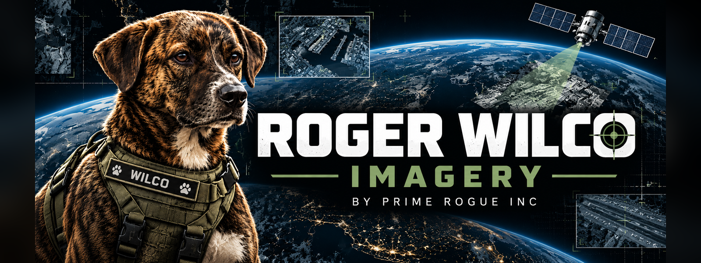

# Roger Wilco Imagery — Las Vegas Watch

Open baseline satellite imagery for the **Vegas Watch** of [Roger Wilco Imagery](https://rogerwilcoimagery.com) (RWI), a project of
Prime Rogue Inc. RWI watches the air bases, test ranges and national-security sites of Las Vegas and the Nevada ranges from open
sources. This repository is the public record of the Watch: the clear-sky reference images that RWI compares new passes against,
and its daily issues.

**Imagery:** 45 clear Sentinel-2 quicklooks: every one of the Watch's 12 places has its own, July–October 2026.

Status: **tested and passed, 9 Nov 2026**. See [TESTS.md](TESTS.md).

## What is here

| Place | Id | Kind | Images | Dates | On the site |
|---|---|---|---|---|---|
| Nellis AFB (Red Flag, USAF Warfare Center) | `nellis-afb` | base / airfield | 4 | 2026-07-15 → 2026-10-26 | [place page](https://rogerwilcoimagery.com/place/nellis-afb.html) |
| Creech AFB (MQ-9 Reaper operations) | `creech-afb` | base / airfield | 4 | 2026-07-16 → 2026-10-26 | [place page](https://rogerwilcoimagery.com/place/creech-afb.html) |
| Groom Lake (Homey Airport, 'Area 51') | `groom-lake` | base / airfield | 3 | 2026-07-18 → 2026-09-24 | [place page](https://rogerwilcoimagery.com/place/groom-lake.html) |
| Tonopah Test Range Airport | `tonopah-test-range` | base / airfield | 4 | 2026-07-11 → 2026-10-24 | [place page](https://rogerwilcoimagery.com/place/tonopah-test-range.html) |
| Nevada National Security Site — Yucca Flat | `nnss-yucca-flat` | base / airfield | 4 | 2026-07-23 → 2026-10-26 | [place page](https://rogerwilcoimagery.com/place/nnss-yucca-flat.html) |
| Nevada National Security Site — Mercury | `nnss-mercury` | base / airfield | 4 | 2026-07-23 → 2026-10-26 | [place page](https://rogerwilcoimagery.com/place/nnss-mercury.html) |
| Yucca Mountain (proposed nuclear waste repository) | `yucca-mountain` | infrastructure | 3 | 2026-07-11 → 2026-09-19 | [place page](https://rogerwilcoimagery.com/place/yucca-mountain.html) |
| Harry Reid International — Janet terminal | `las-vegas-janet` | base / airfield | 4 | 2026-07-03 → 2026-10-26 | [place page](https://rogerwilcoimagery.com/place/las-vegas-janet.html) |
| Hoover Dam and Lake Mead intakes | `hoover-dam-lake-mead` | infrastructure | 4 | 2026-07-15 → 2026-10-26 | [place page](https://rogerwilcoimagery.com/place/hoover-dam-lake-mead.html) |
| NAS Fallon (Naval Aviation Warfighting Development Center, TOPGUN) | `nas-fallon` | base / airfield | 4 | 2026-08-10 → 2026-10-27 | [place page](https://rogerwilcoimagery.com/place/nas-fallon.html) |
| Hawthorne Army Depot | `hawthorne-army-depot` | base / airfield | 3 | 2026-08-08 → 2026-10-17 | [place page](https://rogerwilcoimagery.com/place/hawthorne-army-depot.html) |
| Reno Air National Guard Base (152nd Airlift Wing) | `reno-ang` | base / airfield | 4 | 2026-08-06 → 2026-10-27 | [place page](https://rogerwilcoimagery.com/place/reno-ang.html) |

Every place's box was checked against OpenStreetMap on 9 Nov 2026; none needed moving. See [POSITIONS.md](POSITIONS.md).
The places here are bases, ranges and airfields, so each picture shows the facility and its surroundings at Sentinel-2's 10 m pixel.

- `baselines/<place>/baseline_s2_<date>_<scene>_rgb.jpg` (or `.png`): true-colour quicklook (Sentinel-2 L2A, bands 4-3-2).
- `baselines/<place>/…_rgb.json`: georeference sidecar (CRS, bounds in that CRS, pixel size).
- `index.json`: every image with its scene id, acquisition time (UTC), cloud and clear-sky fractions where scored, and how it was
  cloud-masked. Images marked `"source": "daily_pickup"` were saved by RWI's daily pickup in October rather than by the backfill: same
  frame, checked by eye, but with no cloud score recorded.

## Daily Watch issues

`issues/<date>/` holds each daily Vegas Watch issue, RWI-W-VEGAS-<date>, from 27 Oct 2026 (12 issues to 8 Nov; none on 2 Nov):

- `WATCH.md`: the issue. It covers military, government and Janet flights near the sites for the day before (UTC), from
  community ADS-B; heat detections (NASA FIRMS); and the newest clear Sentinel-2 pass per place.
- `summary.json`: the same in machine-readable form.
- `flights.png` and `S2_<place>.jpg`: the plates.
- `issues/index.json`: every issue with its flight counts and notable lines.

Civil aircraft appear as counts only. Issues are LLM-generated and automated.

Flights come from aircraft that broadcast ADS-B and that volunteer receivers picked up. An aircraft that switches its transponder off
or flies outside coverage is not here, so "none broadcasting" does not mean "none flew". The Nevada Test and Training Range includes
live bombing ranges, so heat inside the range is expected and is listed, not flagged, unless it falls on an airfield or facility box.

## How the images are made

RWI's baseline backfill picks a few clear scenes per place from the past year (up to four per place as of this sync, counting the
daily pickup's), newest first and at least 30 days apart. A scene qualifies only if it covers the place and the scene classification
and RWI's own cloud mask both find it clear. The tiles of one acquisition are mosaicked when a place straddles them. Source:
Sentinel-2 L2A from Element 84 Earth Search and Microsoft Planetary Computer. The quicklooks are for the eye: no raw GeoTIFFs, so they
are not used for RWI's change scores. Three October pickup images were left out after a look (cloud at Hawthorne and Yucca
Mountain, missing data at Groom Lake), so those places have three images.

All times are UTC.

## Licence and attribution

- **Imagery and index (RWI Materials):** see [LICENSE-IMAGERY.md](LICENSE-IMAGERY.md). Underlying data: Copernicus Sentinel, free to
  reuse with attribution. Please credit: **"Contains modified Copernicus Sentinel data 2026, processed by Roger Wilco Imagery."**
- **Code** (if any is added here): MIT, see [LICENSE](LICENSE).

## Prime Rogue

Part of **Roger Wilco Imagery**, Prime Rogue Inc.'s satellite imagery archive.

- [rogerwilcoimagery.com](https://rogerwilcoimagery.com)
- [primerogueinc.com](https://primerogueinc.com)
- [osintyyc.ca](https://osintyyc.ca)

Updated by RWI when new baselines are made. Questions and corrections: via [rogerwilcoimagery.com](https://rogerwilcoimagery.com).
