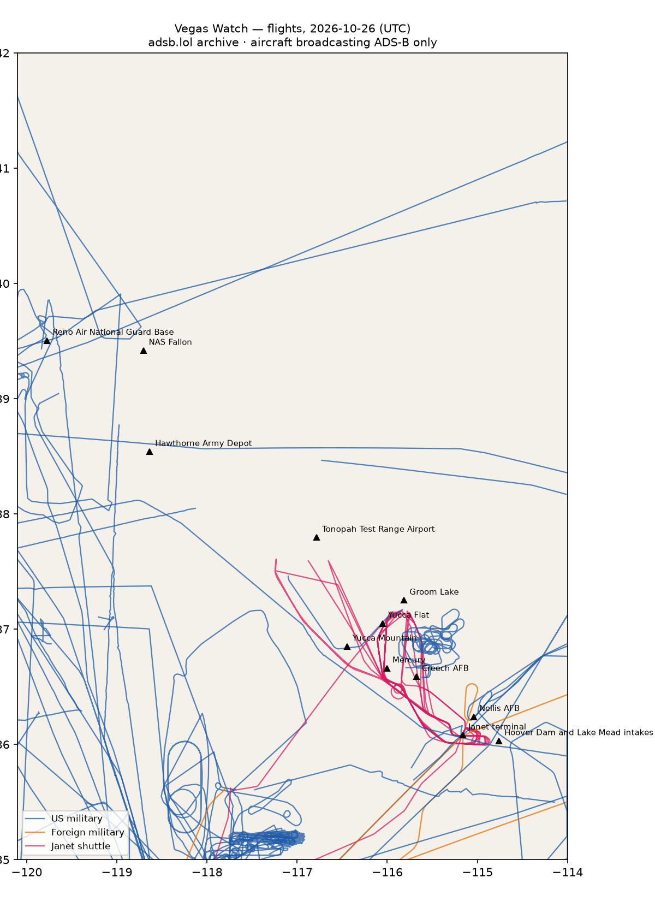

# RWI-W-VEGAS-2026-10-27 — Vegas Watch

*Las Vegas and the Nevada ranges. Daily open-source look; flights for 2026-10-26 (UTC), heat for 2026-10-26–2026-10-27, newest satellite passes. LLM-generated and automated.*

## Notable

- 3 foreign military aircraft in the area (Australia, Germany, Spain).

## Flights

83 aircraft kept: 41 US military, 3 foreign military, 6 Janet, 0 state/VIP, 33 other (on the ground at a site, or near a range).

### Janet shuttles

| Callsign | Reg | Type | Seen (UTC) | Went to |
|---|---|---|---|---|
| JANET13 JANET30 JANET31 JANET33 JANET44 JANET47 JANET53 JANET74 | N273RH | B736 | 07:19–22:32 | Groom Lake (within 25 km) |
| JANET11 JANET15 JANET16 JANET17 JANET22 JANET27 JANET65 JANET76 JANET86 | N869HH | B736 | 10:38–23:33 | Groom Lake (within 25 km), Tonopah Test Range Airport (within 25 km) |
| JANET34 JANET42 JANET46 JANET59 JANET77 JANET87 JANET88 | N319BD | B736 | 12:06–23:08 | Groom Lake (within 25 km), Tonopah Test Range Airport (within 25 km) |
| JANET43 JANET51 JANET62 JANET82 | N365SR | B736 | 13:06–23:38 | Groom Lake (within 25 km) |
| JANET10 | N910CB | BE30 | 14:18–21:53 | Groom Lake (within 25 km) |
| JANET01 | N661BA | BE20 | 18:45–19:10 | — |

### Near Groom Lake and Tonopah Test Range Airport (within 25 km; ordinary traffic below 18,000 ft)

| Aircraft | Type | Category | Callsigns | Seen (UTC) | Sites |
|---|---|---|---|---|---|
| N869HH | B736 | janet | JANET11 JANET15 JANET16 JANET17 JANET22 JANET27 JANET65 JANET76 JANET86 | 10:38–23:33 | Groom Lake, Tonopah Test Range Airport |
| N365SR | B736 | janet | JANET43 JANET51 JANET62 JANET82 | 13:06–23:38 | Groom Lake |
| N273RH | B736 | janet | JANET13 JANET30 JANET31 JANET33 JANET44 JANET47 JANET53 JANET74 | 07:19–22:32 | Groom Lake |
| N319BD | B736 | janet | JANET34 JANET42 JANET46 JANET59 JANET77 JANET87 JANET88 | 12:06–23:08 | Groom Lake, Tonopah Test Range Airport |
| N910CB | BE30 | janet | JANET10 | 14:18–21:53 | Groom Lake |
| N654BA | BE20 | us-military | A89BB0 | 20:05–20:27 | Groom Lake |

### US military

BE20 ×6, T38 ×5, ? ×5, C30J ×4, H60 ×4, C27J ×3, C17 ×3, C5M ×2, K35R ×2, B350 ×1, P8 ×1, C560 ×1, GLF5 ×1, R135 ×1, B762 ×1, C172 ×1.

- 08-8199 C17 THBRD14 at Nellis AFB 22:15 UTC
- 08-20163 H60 EVAC163 R20163 at Harry Reid International — Janet terminal 06:22 UTC
- 17-5567 GLF5 BATT02 ZAPPR11 at Nellis AFB 21:20 UTC
- 62-4135 R135 SNOOP35 at Nellis AFB 21:34 UTC

### Foreign military

- Australia: A39-005 A332 ASY787 17:55–19:06 UTC — at Nellis AFB
- Germany: 54+40 A400 GAF143 19:05–20:07 UTC
- Spain: TK.23-07 A400 AME3170 18:58–19:47 UTC

### Landings and low passes by site

| Site | Military / government aircraft on the ground or ≤1,500 ft within 4 km; civil count |
|---|---|
| Nellis AFB (Red Flag, USAF Warfare Center) | A39-005 A332 (ASY787) 17:55, 17-5567 GLF5 (BATT02 ZAPPR11) 21:20, 62-4135 R135 (SNOOP35) 21:34, 08-8199 C17 (THBRD14) 22:15; 1 civil |
| Creech AFB (MQ-9 Reaper operations) | — |
| Groom Lake (Homey Airport, 'Area 51') | — |
| Tonopah Test Range Airport | — |
| Nevada National Security Site — Yucca Flat | — |
| Nevada National Security Site — Mercury | — |
| Yucca Mountain (proposed nuclear waste repository) | — |
| Harry Reid International — Janet terminal | 08-20163 H60 (EVAC163 R20163) 06:22, N273RH B736 (JANET13 JANET30 JANET31 JANET33 JANET44 JANET47 JANET53 JANET74) 07:19, N869HH B736 (JANET11 JANET15 JANET16 JANET17 JANET22 JANET27 JANET65 JANET76 JANET86) 10:38, N319BD B736 (JANET34 JANET42 JANET46 JANET59 JANET77 JANET87 JANET88) 12:06, N365SR B736 (JANET43 JANET51 JANET62 JANET82) 13:06, N910CB BE30 (JANET10) 14:18, N661BA BE20 (JANET01) 18:45; 4 civil |
| Hoover Dam and Lake Mead intakes | — |
| NAS Fallon (Naval Aviation Warfighting Development Center, TOPGUN) | — |
| Hawthorne Army Depot | — |
| Reno Air National Guard Base (152nd Airlift Wing) | — |

## Heat

25 detections in the watch box (FIRMS area API (agent Gazda)); 0 inside a site box. The Nevada Test and Training Range includes live bombing ranges, so heat detections inside the range are expected and are listed, not flagged, unless they fall on an airfield or facility box.

| Date | UTC | Lat, lon | FRP | Satellite | Site / nearest |
|---|---|---|---|---|---|
| 2026-10-26 | 0900 | 36.356, -114.909 | 2.4 | N21 | Nellis AFB (Red Flag, USAF Warfare Center) (17.4 km) |
| 2026-10-26 | 0900 | 36.383, -114.874 | 0.94 | N21 | Nellis AFB (Red Flag, USAF Warfare Center) (21.8 km) |
| 2026-10-26 | 0937 | 36.357, -114.910 | 1.69 | N | Nellis AFB (Red Flag, USAF Warfare Center) (17.5 km) |
| 2026-10-26 | 0937 | 36.383, -114.876 | 0.87 | N | Nellis AFB (Red Flag, USAF Warfare Center) (21.6 km) |
| 2026-10-26 | 0937 | 36.429, -114.901 | 0.56 | N | Nellis AFB (Red Flag, USAF Warfare Center) (24.4 km) |
| 2026-10-26 | 0958 | 36.358, -114.914 | 1.64 | N20 | Nellis AFB (Red Flag, USAF Warfare Center) (17.3 km) |
| 2026-10-26 | 0958 | 36.382, -114.876 | 0.65 | N20 | Nellis AFB (Red Flag, USAF Warfare Center) (21.6 km) |
| 2026-10-26 | 2057 | 36.143, -115.569 | 3.82 | N | Harry Reid International — Janet terminal (37.4 km) |
| 2026-10-26 | 2057 | 36.146, -115.570 | 3.82 | N | Harry Reid International — Janet terminal (37.6 km) |
| 2026-10-26 | 2118 | 36.141, -115.571 | 8.43 | N20 | Harry Reid International — Janet terminal (37.6 km) |
| 2026-10-26 | 2118 | 36.144, -115.570 | 8.84 | N20 | Harry Reid International — Janet terminal (37.5 km) |
| 2026-10-27 | 0841 | 36.355, -114.912 | 2.34 | N21 | Nellis AFB (Red Flag, USAF Warfare Center) (17.2 km) |
| 2026-10-27 | 0841 | 36.382, -114.876 | 0.56 | N21 | Nellis AFB (Red Flag, USAF Warfare Center) (21.6 km) |
| 2026-10-27 | 0917 | 36.356, -114.909 | 0.85 | N | Nellis AFB (Red Flag, USAF Warfare Center) (17.4 km) |
| 2026-10-27 | 0917 | 36.357, -114.914 | 0.85 | N | Nellis AFB (Red Flag, USAF Warfare Center) (17.2 km) |
| 2026-10-27 | 0917 | 36.382, -114.878 | 0.65 | N | Nellis AFB (Red Flag, USAF Warfare Center) (21.5 km) |
| 2026-10-27 | 0939 | 36.356, -114.910 | 1.64 | N20 | Nellis AFB (Red Flag, USAF Warfare Center) (17.4 km) |
| 2026-10-27 | 0939 | 36.385, -114.877 | 0.72 | N20 | Nellis AFB (Red Flag, USAF Warfare Center) (21.7 km) |
| 2026-10-27 | 1021 | 36.356, -114.913 | 1.56 | N21 | Nellis AFB (Red Flag, USAF Warfare Center) (17.2 km) |
| 2026-10-27 | 2038 | 36.514, -114.761 | 2.79 | N | Nellis AFB (Red Flag, USAF Warfare Center) (39.5 km) |
| 2026-10-27 | 2038 | 36.515, -114.756 | 2.56 | N | Nellis AFB (Red Flag, USAF Warfare Center) (39.8 km) |
| 2026-10-27 | 2038 | 36.517, -114.766 | 2.73 | N | Nellis AFB (Red Flag, USAF Warfare Center) (39.4 km) |
| 2026-10-27 | 2038 | 36.518, -114.762 | 2.73 | N | Nellis AFB (Red Flag, USAF Warfare Center) (39.7 km) |
| 2026-10-27 | 2038 | 36.521, -114.767 | 2.73 | N | Nellis AFB (Red Flag, USAF Warfare Center) (39.6 km) |
| 2026-10-27 | 2040 | 36.524, -114.768 | 3.85 | N | Nellis AFB (Red Flag, USAF Warfare Center) (39.9 km) |

## Imagery

| Site | Newest clear Sentinel-2 pass (≤12 days) | |
|---|---|---|
| Nellis AFB (Red Flag, USAF Warfare Center) | 2026-10-26 18:34 UTC, 100% clear | no new pass |
| Creech AFB (MQ-9 Reaper operations) | 2026-10-26 18:34 UTC, 100% clear | no new pass |
| Groom Lake (Homey Airport, 'Area 51') | 2026-10-26 18:34 UTC, 100% clear | no new pass |
| Tonopah Test Range Airport | 2026-10-24 18:43 UTC, 100% clear | no new pass |
| Nevada National Security Site — Yucca Flat | 2026-10-26 18:34 UTC, 100% clear | no new pass |
| Harry Reid International — Janet terminal | 2026-10-26 18:34 UTC, 100% clear | no new pass |
| Hoover Dam and Lake Mead intakes | 2026-10-26 18:34 UTC, 100% clear | no new pass |

