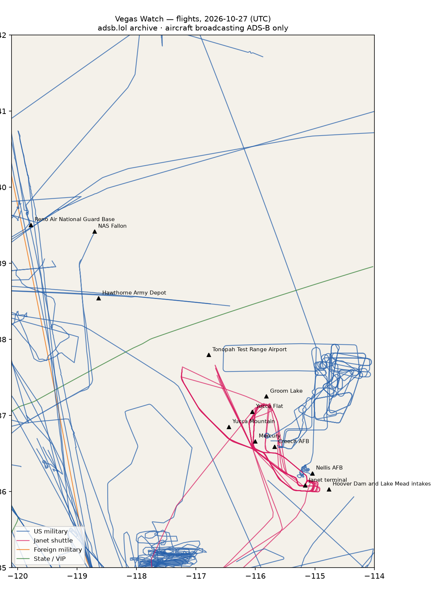

# RWI-W-VEGAS-2026-10-28 — Vegas Watch

*Las Vegas and the Nevada ranges. Daily open-source look; flights for 2026-10-27 (UTC), heat for 2026-10-27–2026-10-28, newest satellite passes. LLM-generated and automated.*

## Notable

- 1 foreign military aircraft in the area (other).

## Flights

90 aircraft kept: 49 US military, 1 foreign military, 6 Janet, 1 state/VIP, 33 other (on the ground at a site, or near a range).

### Janet shuttles

| Callsign | Reg | Type | Seen (UTC) | Went to |
|---|---|---|---|---|
| JANET19 JANET29 JANET33 JANET34 JANET42 JANET43 JANET44 JANET46 JANET59 JANET68 | N319BD | B736 | 00:16–23:07 | Groom Lake (within 25 km) |
| JANET11 JANET17 JANET22 JANET25 JANET26 JANET36 JANET51 JANET62 JANET65 JANET76 JANET82 | N869HH | B736 | 00:25–23:42 | Groom Lake (within 25 km) |
| JANET13 JANET24 JANET47 JANET48 JANET53 JANET55 | N288DP | B736 | 11:00–23:09 | Tonopah Test Range Airport (within 25 km) |
| JANET15 JANET16 JANET27 JANET77 JANET86 JANET87 JANET88 | N273RH | B736 | 12:04–23:31 | Groom Lake (within 25 km) |
| JANET31 JANET37 JANET74 | N365SR | B736 | 12:50–23:28 | — |
| JANET09 | N989RR | BE30 | 14:16–22:58 | Groom Lake (within 25 km), Tonopah Test Range Airport (within 25 km) |

### Near Groom Lake and Tonopah Test Range Airport (within 25 km; ordinary traffic below 18,000 ft)

| Aircraft | Type | Category | Callsigns | Seen (UTC) | Sites |
|---|---|---|---|---|---|
| N288DP | B736 | janet | JANET13 JANET24 JANET47 JANET48 JANET53 JANET55 | 11:00–23:09 | Tonopah Test Range Airport |
| N989RR | BE30 | janet | JANET09 | 14:16–22:58 | Groom Lake, Tonopah Test Range Airport |
| N319BD | B736 | janet | JANET19 JANET29 JANET33 JANET34 JANET42 JANET43 JANET44 JANET46 JANET59 JANET68 | 00:16–23:07 | Groom Lake |
| N869HH | B736 | janet | JANET11 JANET17 JANET22 JANET25 JANET26 JANET36 JANET51 JANET62 JANET65 JANET76 JANET82 | 00:25–23:42 | Groom Lake |
| N273RH | B736 | janet | JANET15 JANET16 JANET27 JANET77 JANET86 JANET87 JANET88 | 12:04–23:31 | Groom Lake |
| af9b5f |  | us-military | CUJO01 | 14:07–17:06 | Tonopah Test Range Airport |

### US military

BE20 ×8, H60 ×7, C17 ×7, ? ×6, EC45 ×4, T38 ×3, C27J ×2, C130 ×2, H47 ×2, C560 ×1, B350 ×1, B762 ×1, P8 ×1, C5M ×1, C30J ×1, E2 ×1, K35R ×1.

- 08-8199 C17 THBRD14 at Nellis AFB 00:26 UTC

### Foreign military

- other: 98-00010 C560 PAT800 14:05–15:31 UTC

### State and VIP

- UR-82027 A124 ANTONOV An-124 Ruslan ADB710F ADB7110 16:22–23:18 UTC

### Landings and low passes by site

| Site | Military / government aircraft on the ground or ≤1,500 ft within 4 km; civil count |
|---|---|
| Nellis AFB (Red Flag, USAF Warfare Center) | 08-8199 C17 (THBRD14) 00:26; 2 civil |
| Creech AFB (MQ-9 Reaper operations) | — |
| Groom Lake (Homey Airport, 'Area 51') | — |
| Tonopah Test Range Airport | — |
| Nevada National Security Site — Yucca Flat | — |
| Nevada National Security Site — Mercury | — |
| Yucca Mountain (proposed nuclear waste repository) | — |
| Harry Reid International — Janet terminal | N319BD B736 (JANET19 JANET29 JANET33 JANET34 JANET42 JANET43 JANET44 JANET46 JANET59 JANET68) 00:43, N869HH B736 (JANET11 JANET17 JANET22 JANET25 JANET26 JANET36 JANET51 JANET62 JANET65 JANET76 JANET82) 00:49, N288DP B736 (JANET13 JANET24 JANET47 JANET48 JANET53 JANET55) 11:00, N273RH B736 (JANET15 JANET16 JANET27 JANET77 JANET86 JANET87 JANET88) 12:04, N365SR B736 (JANET31 JANET37 JANET74) 12:50, N989RR BE30 (JANET09) 14:16; 4 civil |
| Hoover Dam and Lake Mead intakes | — |
| NAS Fallon (Naval Aviation Warfighting Development Center, TOPGUN) | — |
| Hawthorne Army Depot | — |
| Reno Air National Guard Base (152nd Airlift Wing) | — |

## Heat

15 detections in the watch box (FIRMS area API (agent Gazda)); 0 inside a site box. The Nevada Test and Training Range includes live bombing ranges, so heat detections inside the range are expected and are listed, not flagged, unless they fall on an airfield or facility box.

| Date | UTC | Lat, lon | FRP | Satellite | Site / nearest |
|---|---|---|---|---|---|
| 2026-10-27 | 0841 | 36.355, -114.912 | 2.34 | N21 | Nellis AFB (Red Flag, USAF Warfare Center) (17.2 km) |
| 2026-10-27 | 0841 | 36.382, -114.876 | 0.56 | N21 | Nellis AFB (Red Flag, USAF Warfare Center) (21.6 km) |
| 2026-10-27 | 0917 | 36.356, -114.909 | 0.85 | N | Nellis AFB (Red Flag, USAF Warfare Center) (17.4 km) |
| 2026-10-27 | 0917 | 36.357, -114.914 | 0.85 | N | Nellis AFB (Red Flag, USAF Warfare Center) (17.2 km) |
| 2026-10-27 | 0917 | 36.382, -114.878 | 0.65 | N | Nellis AFB (Red Flag, USAF Warfare Center) (21.5 km) |
| 2026-10-27 | 0939 | 36.356, -114.910 | 1.64 | N20 | Nellis AFB (Red Flag, USAF Warfare Center) (17.4 km) |
| 2026-10-27 | 0939 | 36.385, -114.877 | 0.72 | N20 | Nellis AFB (Red Flag, USAF Warfare Center) (21.7 km) |
| 2026-10-27 | 1021 | 36.356, -114.913 | 1.56 | N21 | Nellis AFB (Red Flag, USAF Warfare Center) (17.2 km) |
| 2026-10-27 | 2038 | 36.514, -114.761 | 2.79 | N | Nellis AFB (Red Flag, USAF Warfare Center) (39.5 km) |
| 2026-10-27 | 2038 | 36.515, -114.756 | 2.56 | N | Nellis AFB (Red Flag, USAF Warfare Center) (39.8 km) |
| 2026-10-27 | 2038 | 36.517, -114.766 | 2.73 | N | Nellis AFB (Red Flag, USAF Warfare Center) (39.4 km) |
| 2026-10-27 | 2038 | 36.518, -114.762 | 2.73 | N | Nellis AFB (Red Flag, USAF Warfare Center) (39.7 km) |
| 2026-10-27 | 2038 | 36.521, -114.767 | 2.73 | N | Nellis AFB (Red Flag, USAF Warfare Center) (39.6 km) |
| 2026-10-27 | 2040 | 36.524, -114.768 | 3.85 | N | Nellis AFB (Red Flag, USAF Warfare Center) (39.9 km) |
| 2026-10-28 | 0920 | 36.357, -114.912 | 0.73 | N20 | Nellis AFB (Red Flag, USAF Warfare Center) (17.4 km) |

## Imagery

| Site | Newest clear Sentinel-2 pass (≤12 days) | |
|---|---|---|
| Nellis AFB (Red Flag, USAF Warfare Center) | 2026-10-26 18:34 UTC, 100% clear | no new pass |
| Creech AFB (MQ-9 Reaper operations) | 2026-10-26 18:34 UTC, 100% clear | no new pass |
| Groom Lake (Homey Airport, 'Area 51') | 2026-10-26 18:34 UTC, 100% clear | no new pass |
| Tonopah Test Range Airport | 2026-10-24 18:43 UTC, 100% clear | no new pass |
| Nevada National Security Site — Yucca Flat | 2026-10-26 18:34 UTC, 100% clear | no new pass |
| Harry Reid International — Janet terminal | 2026-10-26 18:34 UTC, 100% clear | no new pass |
| Hoover Dam and Lake Mead intakes | 2026-10-26 18:34 UTC, 100% clear | no new pass |

