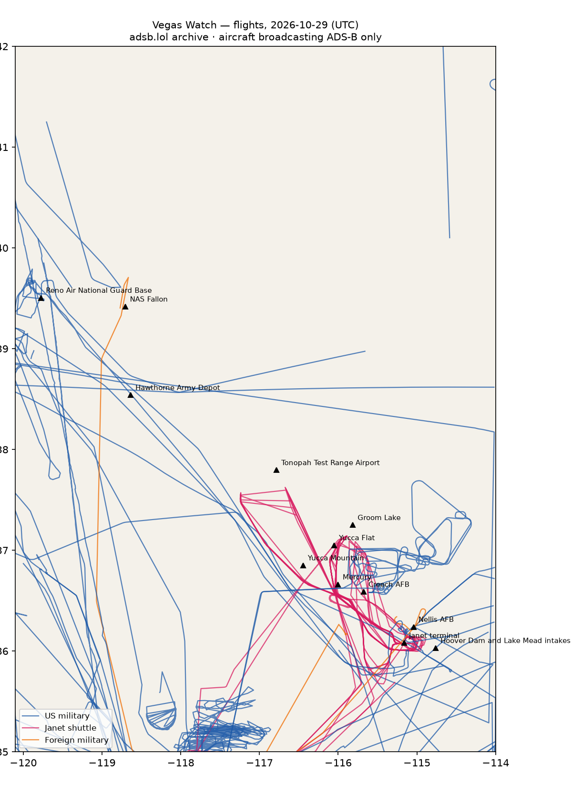

# RWI-W-VEGAS-2026-10-30 — Vegas Watch

*Las Vegas and the Nevada ranges. Daily open-source look; flights for 2026-10-29 (UTC), heat for 2026-10-29–2026-10-30, newest satellite passes. LLM-generated and automated.*

## Notable

- 2 foreign military aircraft in the area (Australia, Canada).

## Flights

98 aircraft kept: 52 US military, 2 foreign military, 5 Janet, 0 state/VIP, 39 other (on the ground at a site, or near a range).

### Janet shuttles

| Callsign | Reg | Type | Seen (UTC) | Went to |
|---|---|---|---|---|
| JANET15 JANET25 JANET26 JANET34 JANET36 JANET37 JANET51 JANET62 JANET77 JANET87 JANET88 JANET98 JANET99 | N319BD | B736 | 00:00–23:58 | Groom Lake (within 25 km) |
| JANET13 JANET24 JANET30 JANET31 JANET37 JANET47 JANET53 JANET55 JANET68 JANET74 | N273RH | B736 | 00:00–22:33 | Tonopah Test Range Airport (within 25 km) |
| JANET16 JANET27 JANET33 JANET42 JANET43 JANET44 JANET46 JANET59 JANET83 JANET84 | N365SR | B736 | 00:00–23:47 | Groom Lake (within 25 km) |
| JANET11 JANET14 JANET17 JANET22 JANET39 JANET48 JANET65 JANET76 JANET82 JANET83 JANET92 JANET93 | N288DP | B736 | 01:03–23:52 | Groom Lake (within 25 km), Tonopah Test Range Airport (within 25 km) |
| JANET10 | N910CB | BE30 | 13:54–23:59 | Groom Lake (within 25 km) |

### Near Groom Lake and Tonopah Test Range Airport (within 25 km; ordinary traffic below 18,000 ft)

| Aircraft | Type | Category | Callsigns | Seen (UTC) | Sites |
|---|---|---|---|---|---|
| N319BD | B736 | janet | JANET15 JANET25 JANET26 JANET34 JANET36 JANET37 JANET51 JANET62 JANET77 JANET87 JANET88 JANET98 JANET99 | 00:00–23:58 | Groom Lake |
| N273RH | B736 | janet | JANET13 JANET24 JANET30 JANET31 JANET37 JANET47 JANET53 JANET55 JANET68 JANET74 | 00:00–22:33 | Tonopah Test Range Airport |
| N365SR | B736 | janet | JANET16 JANET27 JANET33 JANET42 JANET43 JANET44 JANET46 JANET59 JANET83 JANET84 | 00:00–23:47 | Groom Lake |
| N288DP | B736 | janet | JANET11 JANET14 JANET17 JANET22 JANET39 JANET48 JANET65 JANET76 JANET82 JANET83 JANET92 JANET93 | 01:03–23:52 | Groom Lake, Tonopah Test Range Airport |
| N910CB | BE30 | janet | JANET10 | 13:54–23:59 | Groom Lake |

### US military

? ×9, BE20 ×8, T38 ×4, C30J ×4, H60 ×4, C17 ×3, K35R ×3, C130 ×3, C560 ×2, B350 ×2, H47 ×2, EC45 ×2, B737 ×1, E2 ×1, GLF4 ×1, GLF5 ×1, B762 ×1, C27J ×1.

- 05-5142 C17 THBRD14 at Nellis AFB 13:27 UTC
- 166694 B737 CNV4118 at Reno Air National Guard Base 17:07 UTC
- 168208 B350 EASY08 at Nellis AFB 14:16 UTC
- 08-08750 H47 MSTNG50 at Reno Air National Guard Base 18:55 UTC

### Foreign military

- Australia: A41-212 C17 ASY796 00:00–23:59 UTC — at Nellis AFB
- Canada: c3c1b5  N341GW 18:05–22:56 UTC

### Landings and low passes by site

| Site | Military / government aircraft on the ground or ≤1,500 ft within 4 km; civil count |
|---|---|
| Nellis AFB (Red Flag, USAF Warfare Center) | 05-5142 C17 (THBRD14) 13:27, 168208 B350 (EASY08) 14:16, A41-212 C17 (ASY796) 21:36; 2 civil |
| Creech AFB (MQ-9 Reaper operations) | — |
| Groom Lake (Homey Airport, 'Area 51') | — |
| Tonopah Test Range Airport | — |
| Nevada National Security Site — Yucca Flat | — |
| Nevada National Security Site — Mercury | — |
| Yucca Mountain (proposed nuclear waste repository) | — |
| Harry Reid International — Janet terminal | N365SR B736 (JANET16 JANET27 JANET33 JANET42 JANET43 JANET44 JANET46 JANET59 JANET83 JANET84) 00:33, N288DP B736 (JANET11 JANET14 JANET17 JANET22 JANET39 JANET48 JANET65 JANET76 JANET82 JANET83 JANET92 JANET93) 01:03, N273RH B736 (JANET13 JANET24 JANET30 JANET31 JANET37 JANET47 JANET53 JANET55 JANET68 JANET74) 01:29, N319BD B736 (JANET15 JANET25 JANET26 JANET34 JANET36 JANET37 JANET51 JANET62 JANET77 JANET87 JANET88 JANET98 JANET99) 01:35, N910CB BE30 (JANET10) 13:54; 4 civil |
| Hoover Dam and Lake Mead intakes | — |
| NAS Fallon (Naval Aviation Warfighting Development Center, TOPGUN) | — |
| Hawthorne Army Depot | — |
| Reno Air National Guard Base (152nd Airlift Wing) | 166694 B737 (CNV4118) 17:07, 08-08750 H47 (MSTNG50) 18:55 |

## Heat

6 detections in the watch box (FIRMS area API (agent Gazda)); 0 inside a site box. The Nevada Test and Training Range includes live bombing ranges, so heat detections inside the range are expected and are listed, not flagged, unless they fall on an airfield or facility box.

| Date | UTC | Lat, lon | FRP | Satellite | Site / nearest |
|---|---|---|---|---|---|
| 2026-10-29 | 0839 | 36.356, -114.910 | 1.5 | N | Nellis AFB (Red Flag, USAF Warfare Center) (17.4 km) |
| 2026-10-29 | 0839 | 36.357, -114.913 | 1.78 | N | Nellis AFB (Red Flag, USAF Warfare Center) (17.2 km) |
| 2026-10-29 | 0900 | 36.359, -114.914 | 1.39 | N20 | Nellis AFB (Red Flag, USAF Warfare Center) (17.4 km) |
| 2026-10-29 | 0943 | 36.357, -114.911 | 1.28 | N21 | Nellis AFB (Red Flag, USAF Warfare Center) (17.4 km) |
| 2026-10-29 | 0943 | 36.383, -114.875 | 0.81 | N21 | Nellis AFB (Red Flag, USAF Warfare Center) (21.7 km) |
| 2026-10-29 | 0943 | 36.384, -114.878 | 0.76 | N21 | Nellis AFB (Red Flag, USAF Warfare Center) (21.6 km) |

## Imagery

| Site | Newest clear Sentinel-2 pass (≤12 days) | |
|---|---|---|
| Nellis AFB (Red Flag, USAF Warfare Center) | 2026-10-26 18:34 UTC, 94% clear | no new pass |
| Creech AFB (MQ-9 Reaper operations) | 2026-10-26 18:34 UTC, 99% clear | no new pass |
| Groom Lake (Homey Airport, 'Area 51') | 2026-10-26 18:34 UTC, 100% clear | no new pass |
| Tonopah Test Range Airport | 2026-10-24 18:43 UTC, 100% clear | no new pass |
| Nevada National Security Site — Yucca Flat | 2026-10-26 18:34 UTC, 100% clear | no new pass |
| Harry Reid International — Janet terminal | 2026-10-26 18:34 UTC, 91% clear | no new pass |
| Hoover Dam and Lake Mead intakes | 2026-10-26 18:34 UTC, 100% clear | no new pass |

