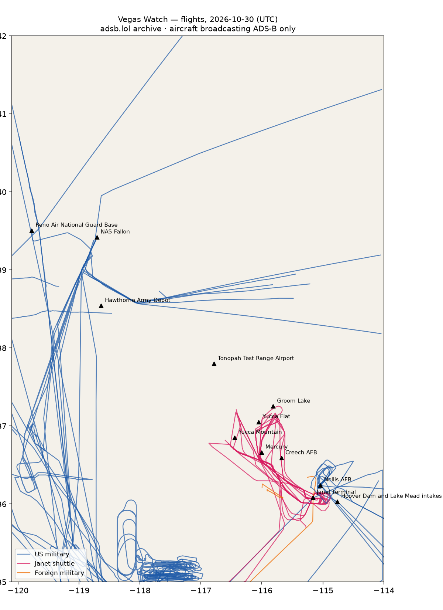

# RWI-W-VEGAS-2026-10-31 — Vegas Watch

*Las Vegas and the Nevada ranges. Daily open-source look; flights for 2026-10-30 (UTC), heat for 2026-10-30–2026-10-31, newest satellite passes. LLM-generated and automated.*

## Notable

- 2 foreign military aircraft in the area (Australia, Canada).

## Flights

73 aircraft kept: 39 US military, 2 foreign military, 6 Janet, 0 state/VIP, 26 other (on the ground at a site, or near a range).

### Janet shuttles

| Callsign | Reg | Type | Seen (UTC) | Went to |
|---|---|---|---|---|
| JANET10 | N910CB | BE30 | 00:00–00:17 | — |
| JANET13 JANET37 JANET47 JANET53 JANET65 JANET68 JANET74 JANET76 | N319BD | B736 | 00:02–23:38 | — |
| JANET15 JANET25 JANET26 JANET36 JANET51 JANET77 JANET86 JANET98 JANET99 | N288DP | B736 | 00:16–23:28 | Groom Lake (within 25 km) |
| JANET84 | N365SR | B736 | 01:02–01:34 | — |
| JANET14 JANET16 JANET33 JANET42 JANET43 JANET46 JANET59 JANET83 JANET88 | N273RH | B736 | 01:03–23:51 | Groom Lake (within 25 km) |
| JANET17 JANET24 JANET30 JANET31 JANET55 JANET82 | N869HH | B736 | 11:00–23:01 | Groom Lake (within 25 km) |

### Near Groom Lake and Tonopah Test Range Airport (within 25 km; ordinary traffic below 18,000 ft)

| Aircraft | Type | Category | Callsigns | Seen (UTC) | Sites |
|---|---|---|---|---|---|
| N273RH | B736 | janet | JANET14 JANET16 JANET33 JANET42 JANET43 JANET46 JANET59 JANET83 JANET88 | 01:03–23:51 | Groom Lake |
| N869HH | B736 | janet | JANET17 JANET24 JANET30 JANET31 JANET55 JANET82 | 11:00–23:01 | Groom Lake |
| N288DP | B736 | janet | JANET15 JANET25 JANET26 JANET36 JANET51 JANET77 JANET86 JANET98 JANET99 | 00:16–23:28 | Groom Lake |

### US military

T38 ×9, BE20 ×6, E2 ×6, C17 ×3, B737 ×2, C560 ×2, H60 ×2, EC45 ×2, K35R ×1, C30J ×1, B350 ×1, P8 ×1, T34T ×1, GLF5 ×1, ? ×1.

- 66-4359 T38 SPIKR17 at Nellis AFB 21:04 UTC
- 65-10467 T38 CARBN29 at Nellis AFB 21:21 UTC
- 166694 B737 CNV4118 at Reno Air National Guard Base 15:34 UTC
- 70-1553 T38 COOL66 at Nellis AFB 20:46 UTC
- 66-4337 T38 COOL50 at Nellis AFB 21:18 UTC
- 66-4379 T38 COOL02 at Nellis AFB 21:47 UTC
- 64-13208 T38 CARBN87 at Nellis AFB 20:52 UTC

### Foreign military

- Australia: A41-212 C17 ASY796 00:00–01:19 UTC
- Canada: c3c1b5  N341GW 17:30–19:48 UTC

### Landings and low passes by site

| Site | Military / government aircraft on the ground or ≤1,500 ft within 4 km; civil count |
|---|---|
| Nellis AFB (Red Flag, USAF Warfare Center) | 70-1553 T38 (COOL66) 20:46, 64-13208 T38 (CARBN87) 20:52, 66-4359 T38 (SPIKR17) 21:04, 66-4337 T38 (COOL50) 21:18, 65-10467 T38 (CARBN29) 21:21, 66-4379 T38 (COOL02) 21:47; 1 civil |
| Creech AFB (MQ-9 Reaper operations) | — |
| Groom Lake (Homey Airport, 'Area 51') | — |
| Tonopah Test Range Airport | — |
| Nevada National Security Site — Yucca Flat | — |
| Nevada National Security Site — Mercury | — |
| Yucca Mountain (proposed nuclear waste repository) | — |
| Harry Reid International — Janet terminal | N319BD B736 (JANET13 JANET37 JANET47 JANET53 JANET65 JANET68 JANET74 JANET76) 00:02, N910CB BE30 (JANET10) 00:09, N288DP B736 (JANET15 JANET25 JANET26 JANET36 JANET51 JANET77 JANET86 JANET98 JANET99) 00:16, N273RH B736 (JANET14 JANET16 JANET33 JANET42 JANET43 JANET46 JANET59 JANET83 JANET88) 01:03, N365SR B736 (JANET84) 01:26, N869HH B736 (JANET17 JANET24 JANET30 JANET31 JANET55 JANET82) 11:00; 4 civil |
| Hoover Dam and Lake Mead intakes | — |
| NAS Fallon (Naval Aviation Warfighting Development Center, TOPGUN) | — |
| Hawthorne Army Depot | — |
| Reno Air National Guard Base (152nd Airlift Wing) | 166694 B737 (CNV4118) 15:34 |

## Heat

0 detections in the watch box (FIRMS area API (agent Gazda)); 0 inside a site box. The Nevada Test and Training Range includes live bombing ranges, so heat detections inside the range are expected and are listed, not flagged, unless they fall on an airfield or facility box.

## Imagery

| Site | Newest clear Sentinel-2 pass (≤12 days) | |
|---|---|---|
| Nellis AFB (Red Flag, USAF Warfare Center) | 2026-10-26 18:34 UTC, 94% clear | no new pass |
| Creech AFB (MQ-9 Reaper operations) | 2026-10-26 18:34 UTC, 99% clear | no new pass |
| Groom Lake (Homey Airport, 'Area 51') | 2026-10-26 18:34 UTC, 100% clear | no new pass |
| Tonopah Test Range Airport | 2026-10-24 18:43 UTC, 100% clear | no new pass |
| Nevada National Security Site — Yucca Flat | 2026-10-26 18:34 UTC, 100% clear | no new pass |
| Harry Reid International — Janet terminal | 2026-10-26 18:34 UTC, 91% clear | no new pass |
| Hoover Dam and Lake Mead intakes | 2026-10-26 18:34 UTC, 100% clear | no new pass |

