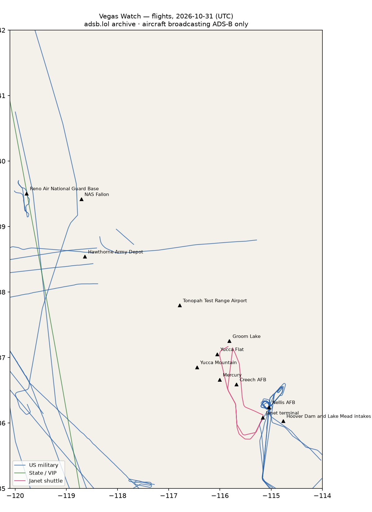

# RWI-W-VEGAS-2026-11-01 — Vegas Watch

*Las Vegas and the Nevada ranges. Daily open-source look; flights for 2026-10-31 (UTC), heat for 2026-10-31–2026-11-01, newest satellite passes. LLM-generated and automated.*

## Notable

- Nothing out of pattern.

## Flights

51 aircraft kept: 24 US military, 0 foreign military, 1 Janet, 1 state/VIP, 25 other (on the ground at a site, or near a range).

### Janet shuttles

| Callsign | Reg | Type | Seen (UTC) | Went to |
|---|---|---|---|---|
| JANET25 JANET26 JANET36 | N288DP | B736 | 00:49–04:07 | Groom Lake (within 25 km) |

### Near Groom Lake and Tonopah Test Range Airport (within 25 km; ordinary traffic below 18,000 ft)

| Aircraft | Type | Category | Callsigns | Seen (UTC) | Sites |
|---|---|---|---|---|---|
| N288DP | B736 | janet | JANET25 JANET26 JANET36 | 00:49–04:07 | Groom Lake |

### US military

TEX2 ×8, C17 ×3, C5M ×2, E2 ×2, BE20 ×1, H60 ×1, T38 ×1, B737 ×1, GLF5 ×1, H47 ×1, ? ×1, C30J ×1, EC45 ×1.

- 95-3002 TEX2 VACA41 at Nellis AFB 01:24 UTC
- 08-3922 TEX2 CARNL51 at Nellis AFB 01:37 UTC
- 03-3682 TEX2 VACA31 at Nellis AFB 00:40 UTC
- 01-3624 TEX2 VACA41 at Nellis AFB 01:17 UTC
- 02-3671 TEX2 CASH21 at Nellis AFB 00:34 UTC
- 08-3907 TEX2 CASH11 at Nellis AFB 00:32 UTC
- 02-3660 TEX2 CARNL51 at Nellis AFB 01:30 UTC
- 00-3573 TEX2 VACA32 at Nellis AFB 00:37 UTC

### Foreign military

None broadcasting.

### State and VIP

- UR-82027 A124 ANTONOV An-124 Ruslan ADB503F 14:39–16:24 UTC

### Landings and low passes by site

| Site | Military / government aircraft on the ground or ≤1,500 ft within 4 km; civil count |
|---|---|
| Nellis AFB (Red Flag, USAF Warfare Center) | 08-3907 TEX2 (CASH11) 00:32, 02-3671 TEX2 (CASH21) 00:34, 00-3573 TEX2 (VACA32) 00:37, 03-3682 TEX2 (VACA31) 00:40, 01-3624 TEX2 (VACA41) 01:17, 95-3002 TEX2 (VACA41) 01:24, 02-3660 TEX2 (CARNL51) 01:30, 08-3922 TEX2 (CARNL51) 01:37 |
| Creech AFB (MQ-9 Reaper operations) | — |
| Groom Lake (Homey Airport, 'Area 51') | — |
| Tonopah Test Range Airport | — |
| Nevada National Security Site — Yucca Flat | — |
| Nevada National Security Site — Mercury | — |
| Yucca Mountain (proposed nuclear waste repository) | — |
| Harry Reid International — Janet terminal | N288DP B736 (JANET25 JANET26 JANET36) 01:15; 3 civil |
| Hoover Dam and Lake Mead intakes | — |
| NAS Fallon (Naval Aviation Warfighting Development Center, TOPGUN) | — |
| Hawthorne Army Depot | — |
| Reno Air National Guard Base (152nd Airlift Wing) | 1 civil |

## Heat

0 detections in the watch box (FIRMS area API (agent Gazda)); 0 inside a site box. The Nevada Test and Training Range includes live bombing ranges, so heat detections inside the range are expected and are listed, not flagged, unless they fall on an airfield or facility box.

## Imagery

| Site | Newest clear Sentinel-2 pass (≤12 days) | |
|---|---|---|
| Nellis AFB (Red Flag, USAF Warfare Center) | 2026-10-26 18:34 UTC, 94% clear | no new pass |
| Creech AFB (MQ-9 Reaper operations) | 2026-10-26 18:34 UTC, 99% clear | no new pass |
| Groom Lake (Homey Airport, 'Area 51') | 2026-10-26 18:34 UTC, 100% clear | no new pass |
| Tonopah Test Range Airport | 2026-10-24 18:43 UTC, 100% clear | no new pass |
| Nevada National Security Site — Yucca Flat | 2026-10-26 18:34 UTC, 100% clear | no new pass |
| Harry Reid International — Janet terminal | 2026-10-26 18:34 UTC, 91% clear | no new pass |
| Hoover Dam and Lake Mead intakes | 2026-10-26 18:34 UTC, 100% clear | no new pass |

