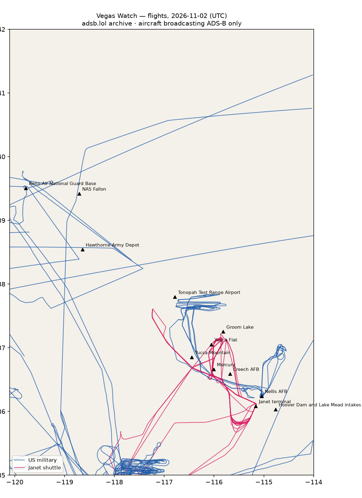

# RWI-W-VEGAS-2026-11-03 — Vegas Watch

*Las Vegas and the Nevada ranges. Daily open-source look; flights for 2026-11-02 (UTC), heat for 2026-11-02–2026-11-03, newest satellite passes. LLM-generated and automated.*

## Notable

- Nothing out of pattern.

## Flights

77 aircraft kept: 33 US military, 0 Canadian military, 0 foreign military, 6 Janet, 0 state/VIP, 38 other (on the ground at a site, or near a range).

### Janet shuttles

| Callsign | Reg | Type | Seen (UTC) | Went to |
|---|---|---|---|---|
| JANET13 JANET30 JANET31 JANET33 JANET44 JANET47 JANET53 JANET74 | N288DP | B736 | 09:34–23:26 | Groom Lake (within 25 km) |
| JANET11 JANET16 JANET17 JANET22 JANET27 JANET65 JANET76 JANET86 | N319BD | B736 | 11:24–23:43 | Groom Lake (within 25 km) |
| JANET34 JANET42 JANET46 JANET59 JANET77 JANET87 JANET88 | N869HH | B736 | 13:10–23:59 | Groom Lake (within 25 km) |
| JANET10 | N910CB | BE30 | 14:08–23:43 | Groom Lake (within 25 km) |
| JANET43 JANET51 JANET82 | N273RH | B736 | 14:09–23:21 | Groom Lake (within 25 km) |
| JANET09 | N989RR | BE30 | 15:45–23:12 | Groom Lake (within 25 km) |

### Near Groom Lake and Tonopah Test Range Airport (within 25 km; ordinary traffic below 18,000 ft)

| Aircraft | Type | Category | Callsigns | Seen (UTC) | Sites |
|---|---|---|---|---|---|
| 95-3002 | TEX2 | us-military | WEASL13 | 21:04–23:34 | Tonopah Test Range Airport |
| 07-3874 | TEX2 | us-military | WEASEL11 | 21:03–23:09 | Tonopah Test Range Airport |
| N288DP | B736 | janet | JANET13 JANET30 JANET31 JANET33 JANET44 JANET47 JANET53 JANET74 | 09:34–23:26 | Groom Lake |
| N989RR | BE30 | janet | JANET09 | 15:45–23:12 | Groom Lake |
| N910CB | BE30 | janet | JANET10 | 14:08–23:43 | Groom Lake |
| N869HH | B736 | janet | JANET34 JANET42 JANET46 JANET59 JANET77 JANET87 JANET88 | 13:10–23:59 | Groom Lake |
| N273RH | B736 | janet | JANET43 JANET51 JANET82 | 14:09–23:21 | Groom Lake |
| N319BD | B736 | janet | JANET11 JANET16 JANET17 JANET22 JANET27 JANET65 JANET76 JANET86 | 11:24–23:43 | Groom Lake |
| 08-3922 | TEX2 | us-military | WEASL12 | 21:05–22:33 | Tonopah Test Range Airport |
| 01-3624 | TEX2 | us-military | WEASEL14 | 21:31–22:58 | Tonopah Test Range Airport |

### US military

T38 ×7, H60 ×6, TEX2 ×4, BE20 ×4, C17 ×3, T34T ×1, B737 ×1, C30J ×1, ? ×1, B762 ×1, C27J ×1, GLF5 ×1, H47 ×1, EC45 ×1.

- 95-3002 TEX2 WEASL13 at Nellis AFB 21:04 UTC
- 07-3874 TEX2 WEASEL11 at Nellis AFB 23:07 UTC
- 70-1553 T38 CARBN11 at Nellis AFB 17:12 UTC
- 66-4379 T38 COOL11 at Nellis AFB 17:18 UTC
- 66-4359 T38 CARBN12 at Nellis AFB 17:51 UTC

### Foreign military

None broadcasting.

### Landings and low passes by site

| Site | Military / government aircraft on the ground or ≤1,500 ft within 4 km; civil count |
|---|---|
| Nellis AFB (Red Flag, USAF Warfare Center) | 70-1553 T38 (CARBN11) 17:12, 66-4379 T38 (COOL11) 17:18, 66-4359 T38 (CARBN12) 17:51, 95-3002 TEX2 (WEASL13) 21:04, 07-3874 TEX2 (WEASEL11) 23:07 |
| Creech AFB (MQ-9 Reaper operations) | — |
| Groom Lake (Homey Airport, 'Area 51') | — |
| Tonopah Test Range Airport | — |
| Nevada National Security Site — Yucca Flat | — |
| Nevada National Security Site — Mercury | — |
| Yucca Mountain (proposed nuclear waste repository) | — |
| Harry Reid International — Janet terminal | N288DP B736 (JANET13 JANET30 JANET31 JANET33 JANET44 JANET47 JANET53 JANET74) 09:34, N319BD B736 (JANET11 JANET16 JANET17 JANET22 JANET27 JANET65 JANET76 JANET86) 11:24, N869HH B736 (JANET34 JANET42 JANET46 JANET59 JANET77 JANET87 JANET88) 13:10, N910CB BE30 (JANET10) 14:08, N273RH B736 (JANET43 JANET51 JANET82) 14:09, N989RR BE30 (JANET09) 15:45; 3 civil |
| Hoover Dam and Lake Mead intakes | — |
| NAS Fallon (Naval Aviation Warfighting Development Center, TOPGUN) | — |
| Hawthorne Army Depot | — |
| Reno Air National Guard Base (152nd Airlift Wing) | — |

## Heat

8 detections in the watch box (FIRMS area API (agent Gazda)); 0 inside a site box. The Nevada Test and Training Range includes live bombing ranges, so heat detections inside the range are expected and are listed, not flagged, unless they fall on an airfield or facility box.

| Date | UTC | Lat, lon | FRP | Satellite | Site / nearest |
|---|---|---|---|---|---|
| 2026-11-02 | 0828 | 36.356, -114.910 | 1.84 | N21 | Nellis AFB (Red Flag, USAF Warfare Center) (17.4 km) |
| 2026-11-02 | 0906 | 36.357, -114.914 | 1.81 | N | Nellis AFB (Red Flag, USAF Warfare Center) (17.3 km) |
| 2026-11-02 | 0926 | 36.359, -114.910 | 0.65 | N20 | Nellis AFB (Red Flag, USAF Warfare Center) (17.6 km) |
| 2026-11-02 | 0926 | 36.359, -114.914 | 0.65 | N20 | Nellis AFB (Red Flag, USAF Warfare Center) (17.4 km) |
| 2026-11-02 | 0926 | 36.383, -114.875 | 0.8 | N20 | Nellis AFB (Red Flag, USAF Warfare Center) (21.7 km) |
| 2026-11-02 | 1010 | 36.357, -114.911 | 1.93 | N21 | Nellis AFB (Red Flag, USAF Warfare Center) (17.4 km) |
| 2026-11-03 | 0949 | 36.358, -114.911 | 1.32 | N21 | Nellis AFB (Red Flag, USAF Warfare Center) (17.5 km) |
| 2026-11-03 | 0949 | 36.359, -114.913 | 1.13 | N21 | Nellis AFB (Red Flag, USAF Warfare Center) (17.4 km) |

## Imagery

| Site | Newest clear Sentinel-2 pass (≤12 days) | |
|---|---|---|
| Nellis AFB (Red Flag, USAF Warfare Center) | 2026-10-26 18:34 UTC, 94% clear | no new pass |
| Creech AFB (MQ-9 Reaper operations) | 2026-11-03 18:44 UTC, 99% clear | [new plate](S2_creech-afb.jpg) |
| Groom Lake (Homey Airport, 'Area 51') | 2026-11-03 18:43 UTC, 99% clear | [new plate](S2_groom-lake.jpg) |
| Tonopah Test Range Airport | 2026-11-03 18:43 UTC, 100% clear | [new plate](S2_tonopah-test-range.jpg) |
| Nevada National Security Site — Yucca Flat | 2026-11-03 18:43 UTC, 100% clear | [new plate](S2_nnss-yucca-flat.jpg) |
| Harry Reid International — Janet terminal | 2026-10-26 18:34 UTC, 91% clear | no new pass |
| Hoover Dam and Lake Mead intakes | 2026-10-26 18:34 UTC, 100% clear | no new pass |

