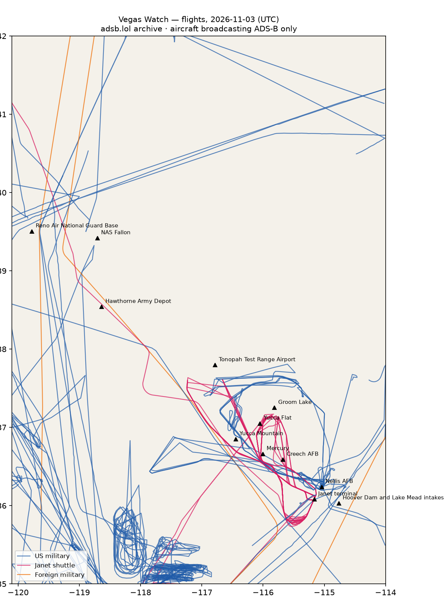

# RWI-W-VEGAS-2026-11-04 — Vegas Watch

*Las Vegas and the Nevada ranges. Daily open-source look; flights for 2026-11-03 (UTC), heat for 2026-11-03–2026-11-04, newest satellite passes. LLM-generated and automated.*

## Notable

- 2 foreign military aircraft in the area (United Kingdom, other).

## Flights

87 aircraft kept: 49 US military, 0 Canadian military, 2 foreign military, 7 Janet, 0 state/VIP, 29 other (on the ground at a site, or near a range).

### Janet shuttles

| Callsign | Reg | Type | Seen (UTC) | Went to |
|---|---|---|---|---|
| JANET11 JANET17 JANET22 JANET51 JANET59 JANET65 JANET68 JANET76 JANET82 | N869HH | B736 | 00:00–23:24 | Groom Lake (within 25 km), Tonopah Test Range Airport (within 25 km) |
| JANET15 JANET25 JANET26 JANET33 JANET34 JANET36 JANET42 JANET43 JANET44 JANET46 JANET59 | N319BD | B736 | 00:10–23:54 | Groom Lake (within 25 km) |
| JANET13 JANET24 JANET37 JANET47 JANET53 JANET55 JANET62 JANET74 | N273RH | B736 | 00:11–23:59 | Groom Lake (within 25 km), Tonopah Test Range Airport (within 25 km) |
| JANET15 JANET16 JANET27 JANET77 JANET86 JANET87 JANET88 | N288DP | B736 | 13:06–23:45 | Groom Lake (within 25 km) |
| JANET31 JANET48 | N365SR | B736 | 13:51–23:59 | — |
| JANET09 | N989RR | BE30 | 14:52–23:59 | Groom Lake (within 25 km) |
| JANET99 | N859WP | B736 | 18:09–19:23 | — |

### Near Groom Lake and Tonopah Test Range Airport (within 25 km; ordinary traffic below 18,000 ft)

| Aircraft | Type | Category | Callsigns | Seen (UTC) | Sites |
|---|---|---|---|---|---|
| N989RR | BE30 | janet | JANET09 | 14:52–23:59 | Groom Lake |
| 66-4359 | T38 | us-military | SCALP02 STORMY4 | 18:17–22:04 | Tonopah Test Range Airport |
| N319BD | B736 | janet | JANET15 JANET25 JANET26 JANET33 JANET34 JANET36 JANET42 JANET43 JANET44 JANET46 JANET59 | 00:10–23:54 | Groom Lake |
| 66-4337 | T38 | us-military | SCALP04 STRMY01 | 18:06–22:25 | Tonopah Test Range Airport |
| N288DP | B736 | janet | JANET15 JANET16 JANET27 JANET77 JANET86 JANET87 JANET88 | 13:06–23:45 | Groom Lake |
| N869HH | B736 | janet | JANET11 JANET17 JANET22 JANET51 JANET59 JANET65 JANET68 JANET76 JANET82 | 00:00–23:24 | Groom Lake, Tonopah Test Range Airport |
| N273RH | B736 | janet | JANET13 JANET24 JANET37 JANET47 JANET53 JANET55 JANET62 JANET74 | 00:11–23:59 | Groom Lake, Tonopah Test Range Airport |
| 66-4379 | T38 | us-military | SCALP03 STORMY3 | 18:30–22:04 | Tonopah Test Range Airport |

### US military

BE20 ×8, T38 ×7, K35R ×6, TEX2 ×4, H60 ×4, C17 ×3, C560 ×2, ? ×2, EC45 ×2, GLF5 ×1, C30J ×1, H47 ×1, B762 ×1, GLF4 ×1, T34T ×1, B350 ×1, C130 ×1, LJ35 ×1, B742 ×1, C27J ×1.

- 17-5567 GLF5 BATT13 PABLO15 TRON21 at Nellis AFB 21:23 UTC
- 18-5906 C30J 185906 ROYAL34 at Nellis AFB 21:55 UTC
- 66-4359 T38 SCALP02 STORMY4 at Nellis AFB 19:09 UTC
- 66-4337 T38 SCALP04 STRMY01 at Nellis AFB 18:06 UTC
- 02-3660 TEX2 WEASEL01 at Nellis AFB 22:45 UTC
- 64-13208 T38 643208 SCALP01 at Nellis AFB 18:03 UTC
- 14-14481 H60 MS02 at Nellis AFB 19:27 UTC
- 93-1039 C130 BRAVE39 at Nellis AFB 21:52 UTC

### Foreign military

- other: 98-00010 C560 LOST11 LOST15 02:59–23:59 UTC
- United Kingdom: ZZ174 C17 RRR6101 17:26–19:31 UTC

### Landings and low passes by site

| Site | Military / government aircraft on the ground or ≤1,500 ft within 4 km; civil count |
|---|---|
| Nellis AFB (Red Flag, USAF Warfare Center) | 64-13208 T38 (643208 SCALP01) 18:03, 66-4337 T38 (SCALP04 STRMY01) 18:06, 66-4359 T38 (SCALP02 STORMY4) 19:09, 14-14481 H60 (MS02) 19:27, 17-5567 GLF5 (BATT13 PABLO15 TRON21) 21:23, 93-1039 C130 (BRAVE39) 21:52, 18-5906 C30J (185906 ROYAL34) 21:55, 02-3660 TEX2 (WEASEL01) 22:45 |
| Creech AFB (MQ-9 Reaper operations) | — |
| Groom Lake (Homey Airport, 'Area 51') | — |
| Tonopah Test Range Airport | — |
| Nevada National Security Site — Yucca Flat | — |
| Nevada National Security Site — Mercury | — |
| Yucca Mountain (proposed nuclear waste repository) | — |
| Harry Reid International — Janet terminal | N319BD B736 (JANET15 JANET25 JANET26 JANET33 JANET34 JANET36 JANET42 JANET43 JANET44 JANET46 JANET59) 00:10, N273RH B736 (JANET13 JANET24 JANET37 JANET47 JANET53 JANET55 JANET62 JANET74) 00:37, N869HH B736 (JANET11 JANET17 JANET22 JANET51 JANET59 JANET65 JANET68 JANET76 JANET82) 01:42, N288DP B736 (JANET15 JANET16 JANET27 JANET77 JANET86 JANET87 JANET88) 13:06, N365SR B736 (JANET31 JANET48) 13:51, N989RR BE30 (JANET09) 14:52, N859WP B736 (JANET99) 19:22; 3 civil |
| Hoover Dam and Lake Mead intakes | — |
| NAS Fallon (Naval Aviation Warfighting Development Center, TOPGUN) | — |
| Hawthorne Army Depot | — |
| Reno Air National Guard Base (152nd Airlift Wing) | — |

## Heat

5 detections in the watch box (FIRMS area API (agent Gazda)); 0 inside a site box. The Nevada Test and Training Range includes live bombing ranges, so heat detections inside the range are expected and are listed, not flagged, unless they fall on an airfield or facility box.

| Date | UTC | Lat, lon | FRP | Satellite | Site / nearest |
|---|---|---|---|---|---|
| 2026-11-03 | 0949 | 36.358, -114.911 | 1.32 | N21 | Nellis AFB (Red Flag, USAF Warfare Center) (17.5 km) |
| 2026-11-03 | 0949 | 36.359, -114.913 | 1.13 | N21 | Nellis AFB (Red Flag, USAF Warfare Center) (17.4 km) |
| 2026-11-04 | 0847 | 36.358, -114.916 | 1.39 | N20 | Nellis AFB (Red Flag, USAF Warfare Center) (17.2 km) |
| 2026-11-04 | 0932 | 36.357, -114.913 | 1.76 | N21 | Nellis AFB (Red Flag, USAF Warfare Center) (17.3 km) |
| 2026-11-04 | 0932 | 36.382, -114.876 | 0.76 | N21 | Nellis AFB (Red Flag, USAF Warfare Center) (21.6 km) |

## Imagery

| Site | Newest clear Sentinel-2 pass (≤12 days) | |
|---|---|---|
| Nellis AFB (Red Flag, USAF Warfare Center) | 2026-10-26 18:34 UTC, 94% clear | no new pass |
| Creech AFB (MQ-9 Reaper operations) | 2026-11-03 18:44 UTC, 99% clear | no new pass |
| Groom Lake (Homey Airport, 'Area 51') | 2026-11-03 18:43 UTC, 99% clear | no new pass |
| Tonopah Test Range Airport | 2026-11-03 18:43 UTC, 100% clear | no new pass |
| Nevada National Security Site — Yucca Flat | 2026-11-03 18:43 UTC, 100% clear | no new pass |
| Harry Reid International — Janet terminal | 2026-10-26 18:34 UTC, 91% clear | no new pass |
| Hoover Dam and Lake Mead intakes | 2026-10-26 18:34 UTC, 100% clear | no new pass |

