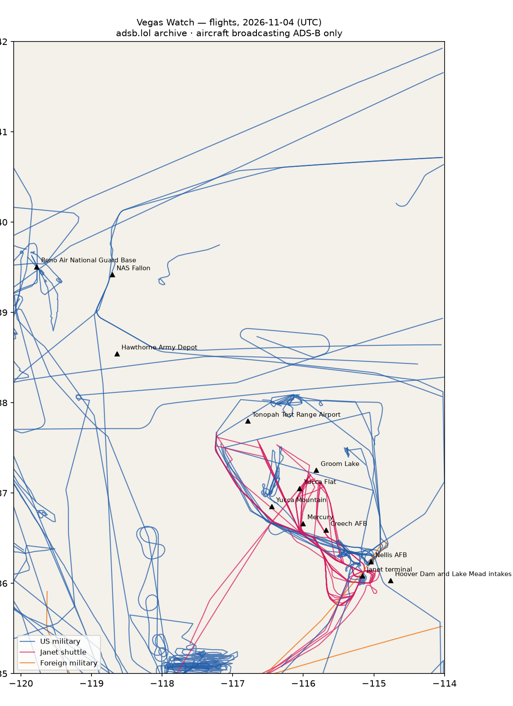

# RWI-W-VEGAS-2026-11-05 — Vegas Watch

*Las Vegas and the Nevada ranges. Daily open-source look; flights for 2026-11-04 (UTC), heat for 2026-11-04–2026-11-05, newest satellite passes. LLM-generated and automated.*

## Notable

- 2 foreign military aircraft in the area (Australia, other).

## Flights

98 aircraft kept: 51 US military, 0 Canadian military, 2 foreign military, 8 Janet, 0 state/VIP, 37 other (on the ground at a site, or near a range).

### Janet shuttles

| Callsign | Reg | Type | Seen (UTC) | Went to |
|---|---|---|---|---|
| JANET33 JANET34 JANET37 JANET42 JANET43 JANET44 JANET46 JANET59 JANET68 | N273RH | B736 | 00:00–23:59 | Groom Lake (within 25 km) |
| JANET09 | N989RR | BE30 | 00:00–23:09 | — |
| JANET48 | N365SR | B736 | 00:00–00:09 | — |
| JANET11 JANET15 JANET17 JANET22 JANET25 JANET26 JANET36 JANET51 JANET65 JANET76 JANET82 | N288DP | B736 | 00:06–23:26 | Groom Lake (within 25 km) |
| JANET14 JANET16 JANET27 JANET62 JANET77 JANET83 JANET86 JANET87 JANET88 | N869HH | B736 | 00:11–23:39 | Groom Lake (within 25 km) |
| JANET31 JANET74 JANET84 | N319BD | B736 | 01:04–23:45 | — |
| JANET13 JANET24 JANET47 JANET48 JANET53 JANET55 | N859WP | B736 | 11:59–23:59 | — |
| JANET10 | N910CB | BE30 | 14:53–23:59 | Groom Lake (within 25 km) |

### Near Groom Lake and Tonopah Test Range Airport (within 25 km; ordinary traffic below 18,000 ft)

| Aircraft | Type | Category | Callsigns | Seen (UTC) | Sites |
|---|---|---|---|---|---|
| N288DP | B736 | janet | JANET11 JANET15 JANET17 JANET22 JANET25 JANET26 JANET36 JANET51 JANET65 JANET76 JANET82 | 00:06–23:26 | Groom Lake |
| N869HH | B736 | janet | JANET14 JANET16 JANET27 JANET62 JANET77 JANET83 JANET86 JANET87 JANET88 | 00:11–23:39 | Groom Lake |
| N273RH | B736 | janet | JANET33 JANET34 JANET37 JANET42 JANET43 JANET44 JANET46 JANET59 JANET68 | 00:00–23:59 | Groom Lake |
| N910CB | BE30 | janet | JANET10 | 14:53–23:59 | Groom Lake |

### US military

H60 ×7, T38 ×7, TEX2 ×6, BE20 ×4, C17 ×4, EC45 ×4, C30J ×3, C130 ×2, GLF5 ×2, K35R ×2, C27J ×2, B737 ×2, H47 ×1, C560 ×1, R135 ×1, T34T ×1, B762 ×1, F5 ×1.

- 02-3660 TEX2 WEASEL01 at Nellis AFB 00:54 UTC
- 66-4337 T38 STRMY03 at Nellis AFB 20:26 UTC
- 93-0599 C17 RCH405 at Reno Air National Guard Base 00:22 UTC
- 92-0554 C130 ROLER30 at Reno Air National Guard Base 18:36 UTC
- 97-3017 TEX2 WEASEL03 at Nellis AFB 01:09 UTC
- 08-3922 TEX2 WEASL04 at Nellis AFB 22:15 UTC
- 17-5567 GLF5 PABLO15 TRON31 ZAPPR01 at Nellis AFB 02:45 UTC
- 66-4359 T38 STORMY1 at Nellis AFB 19:31 UTC
- 01-3624 TEX2 WEASEL03 at Nellis AFB 21:49 UTC
- 93-1039 C130 BRAVE39 at Nellis AFB 17:20 UTC
- 62-4135 R135 SNOOP35 at Nellis AFB 21:02 UTC

### Foreign military

- other: 98-00010 C560 LOST15 PAT970 00:00–19:45 UTC
- Australia: A41-211 C17 ASY802 06:09–22:46 UTC — at Nellis AFB

### Landings and low passes by site

| Site | Military / government aircraft on the ground or ≤1,500 ft within 4 km; civil count |
|---|---|
| Nellis AFB (Red Flag, USAF Warfare Center) | 02-3660 TEX2 (WEASEL01) 00:54, 97-3017 TEX2 (WEASEL03) 01:09, 17-5567 GLF5 (PABLO15 TRON31 ZAPPR01) 02:45, A41-211 C17 (ASY802) 07:01, 93-1039 C130 (BRAVE39) 17:20, 66-4359 T38 (STORMY1) 19:31, 66-4337 T38 (STRMY03) 20:26, 62-4135 R135 (SNOOP35) 21:02, 01-3624 TEX2 (WEASEL03) 21:49, 08-3922 TEX2 (WEASL04) 22:15 |
| Creech AFB (MQ-9 Reaper operations) | — |
| Groom Lake (Homey Airport, 'Area 51') | — |
| Tonopah Test Range Airport | — |
| Nevada National Security Site — Yucca Flat | — |
| Nevada National Security Site — Mercury | — |
| Yucca Mountain (proposed nuclear waste repository) | — |
| Harry Reid International — Janet terminal | N273RH B736 (JANET33 JANET34 JANET37 JANET42 JANET43 JANET44 JANET46 JANET59 JANET68) 00:00, N365SR B736 (JANET48) 00:05, N288DP B736 (JANET11 JANET15 JANET17 JANET22 JANET25 JANET26 JANET36 JANET51 JANET65 JANET76 JANET82) 00:06, N869HH B736 (JANET14 JANET16 JANET27 JANET62 JANET77 JANET83 JANET86 JANET87 JANET88) 00:37, N319BD B736 (JANET31 JANET74 JANET84) 01:35, N989RR BE30 (JANET09) 02:22, N859WP B736 (JANET13 JANET24 JANET47 JANET48 JANET53 JANET55) 11:59, N910CB BE30 (JANET10) 14:53; 5 civil |
| Hoover Dam and Lake Mead intakes | — |
| NAS Fallon (Naval Aviation Warfighting Development Center, TOPGUN) | — |
| Hawthorne Army Depot | — |
| Reno Air National Guard Base (152nd Airlift Wing) | 93-0599 C17 (RCH405) 00:22, 92-0554 C130 (ROLER30) 18:36 |

## Heat

6 detections in the watch box (FIRMS area API (agent Gazda)); 0 inside a site box. The Nevada Test and Training Range includes live bombing ranges, so heat detections inside the range are expected and are listed, not flagged, unless they fall on an airfield or facility box.

| Date | UTC | Lat, lon | FRP | Satellite | Site / nearest |
|---|---|---|---|---|---|
| 2026-11-04 | 0847 | 36.358, -114.916 | 1.39 | N20 | Nellis AFB (Red Flag, USAF Warfare Center) (17.2 km) |
| 2026-11-04 | 0932 | 36.357, -114.913 | 1.76 | N21 | Nellis AFB (Red Flag, USAF Warfare Center) (17.3 km) |
| 2026-11-04 | 0932 | 36.382, -114.876 | 0.76 | N21 | Nellis AFB (Red Flag, USAF Warfare Center) (21.6 km) |
| 2026-11-05 | 0913 | 36.358, -114.911 | 1.79 | N21 | Nellis AFB (Red Flag, USAF Warfare Center) (17.5 km) |
| 2026-11-05 | 0913 | 36.383, -114.878 | 0.93 | N21 | Nellis AFB (Red Flag, USAF Warfare Center) (21.6 km) |
| 2026-11-05 | 1010 | 36.358, -114.913 | 1.51 | N20 | Nellis AFB (Red Flag, USAF Warfare Center) (17.3 km) |

## Imagery

| Site | Newest clear Sentinel-2 pass (≤12 days) | |
|---|---|---|
| Nellis AFB (Red Flag, USAF Warfare Center) | 2026-11-05 18:34 UTC, 94% clear | [new plate](S2_nellis-afb.jpg) |
| Creech AFB (MQ-9 Reaper operations) | 2026-11-05 18:44 UTC, 82% clear | [new plate](S2_creech-afb.jpg) |
| Groom Lake (Homey Airport, 'Area 51') | 2026-11-05 18:44 UTC, 99% clear | [new plate](S2_groom-lake.jpg) |
| Tonopah Test Range Airport | 2026-11-05 18:44 UTC, 100% clear | [new plate](S2_tonopah-test-range.jpg) |
| Nevada National Security Site — Yucca Flat | 2026-11-05 18:44 UTC, 100% clear | [new plate](S2_nnss-yucca-flat.jpg) |
| Harry Reid International — Janet terminal | 2026-10-26 18:34 UTC, 91% clear | no new pass |
| Hoover Dam and Lake Mead intakes | 2026-11-05 18:34 UTC, 100% clear | [new plate](S2_hoover-dam-lake-mead.jpg) |

