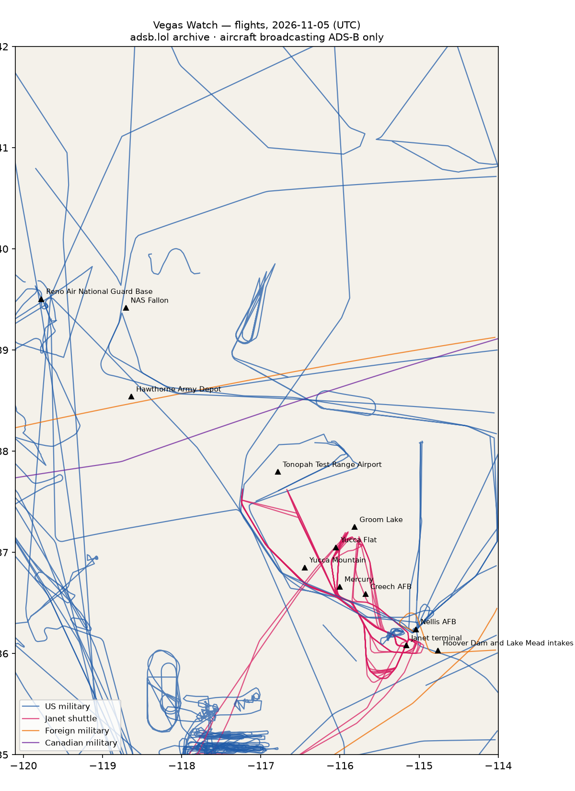

# RWI-W-VEGAS-2026-11-06 — Vegas Watch

*Las Vegas and the Nevada ranges. Daily open-source look; flights for 2026-11-05 (UTC), heat for 2026-11-05–2026-11-06, newest satellite passes. LLM-generated and automated.*

## Notable

- 3 foreign military aircraft in the area (Australia, France, other).

## Flights

91 aircraft kept: 42 US military, 1 Canadian military, 3 foreign military, 7 Janet, 0 state/VIP, 38 other (on the ground at a site, or near a range).

### Janet shuttles

| Callsign | Reg | Type | Seen (UTC) | Went to |
|---|---|---|---|---|
| JANET33 JANET34 JANET42 JANET43 JANET44 JANET46 JANET59 JANET84 | N273RH | B736 | 00:00–23:59 | Groom Lake (within 25 km) |
| JANET10 | N910CB | BE30 | 00:00–01:51 | — |
| JANET14 JANET31 JANET37 JANET48 JANET74 JANET83 | N859WP | B736 | 00:00–23:59 | — |
| JANET11 JANET17 JANET22 JANET25 JANET36 JANET51 JANET62 JANET65 JANET76 JANET82 | N288DP | B736 | 00:11–23:19 | Groom Lake (within 25 km), Tonopah Test Range Airport (within 25 km) |
| JANET16 JANET27 JANET37 JANET68 JANET77 JANET86 JANET87 JANET88 | N319BD | B736 | 00:17–23:42 | Groom Lake (within 25 km) |
| JANET13 JANET15 JANET24 JANET26 JANET47 JANET48 JANET53 JANET55 | N869HH | B736 | 00:21–23:59 | Groom Lake (within 25 km), Tonopah Test Range Airport (within 25 km) |
| JANET09 | N989RR | BE30 | 15:08–23:59 | Groom Lake (within 25 km) |

### Near Groom Lake and Tonopah Test Range Airport (within 25 km; ordinary traffic below 18,000 ft)

| Aircraft | Type | Category | Callsigns | Seen (UTC) | Sites |
|---|---|---|---|---|---|
| N869HH | B736 | janet | JANET13 JANET15 JANET24 JANET26 JANET47 JANET48 JANET53 JANET55 | 00:21–23:59 | Groom Lake, Tonopah Test Range Airport |
| 66-4359 | T38 | us-military | STRMY01 | 19:35–21:13 | Tonopah Test Range Airport |
| N319BD | B736 | janet | JANET16 JANET27 JANET37 JANET68 JANET77 JANET86 JANET87 JANET88 | 00:17–23:42 | Groom Lake |
| N989RR | BE30 | janet | JANET09 | 15:08–23:59 | Groom Lake |
| N273RH | B736 | janet | JANET33 JANET34 JANET42 JANET43 JANET44 JANET46 JANET59 JANET84 | 00:00–23:59 | Groom Lake |
| N288DP | B736 | janet | JANET11 JANET17 JANET22 JANET25 JANET36 JANET51 JANET62 JANET65 JANET76 JANET82 | 00:11–23:19 | Groom Lake, Tonopah Test Range Airport |
| 66-4379 | T38 | us-military | STORMY2 | 20:22–20:40 | Tonopah Test Range Airport |
| 70-1553 | T38 | us-military | STORMY4 | 20:30–20:43 | Tonopah Test Range Airport |

### US military

T38 ×7, H60 ×5, BE20 ×4, B737 ×3, C27J ×3, TEX2 ×2, C560 ×2, K35R ×2, EC45 ×2, ? ×2, B762 ×1, GLF5 ×1, C17 ×1, B350 ×1, R135 ×1, GLF4 ×1, C130 ×1, C30J ×1, PC12 ×1, F5 ×1.

- 17-5567 GLF5 PABLO15 ZAPPR01 at Nellis AFB 18:08 UTC
- 66-4359 T38 STRMY01 at Nellis AFB 19:35 UTC
- 08-3907 TEX2 WEASEL03 at Nellis AFB 22:05 UTC
- 95-00095 BE20 PAT272 at Reno Air National Guard Base 21:11 UTC
- 64-13208 T38 643208 at Nellis AFB 20:39 UTC
- 62-4135 R135 SNOOP35 at Nellis AFB 03:51 UTC
- 93-1039 C130 BRAVE39 at Nellis AFB 19:26 UTC

### Canadian military

- 144618 CL60 CFC3016 CFC3120 19:18–20:27 UTC

### Foreign military

- other: 98-00010 C560 PAT970 00:54–01:46 UTC
- Australia: A41-211 C17 ASY802 00:20–00:41 UTC — at Nellis AFB
- France: 5836 C30J CTM2081 02:00–19:11 UTC

### Landings and low passes by site

| Site | Military / government aircraft on the ground or ≤1,500 ft within 4 km; civil count |
|---|---|
| Nellis AFB (Red Flag, USAF Warfare Center) | A41-211 C17 (ASY802) 00:20, 62-4135 R135 (SNOOP35) 03:51, 17-5567 GLF5 (PABLO15 ZAPPR01) 18:08, 93-1039 C130 (BRAVE39) 19:26, 66-4359 T38 (STRMY01) 19:35, 64-13208 T38 (643208) 20:39, 08-3907 TEX2 (WEASEL03) 22:05; 2 civil |
| Creech AFB (MQ-9 Reaper operations) | — |
| Groom Lake (Homey Airport, 'Area 51') | — |
| Tonopah Test Range Airport | — |
| Nevada National Security Site — Yucca Flat | — |
| Nevada National Security Site — Mercury | — |
| Yucca Mountain (proposed nuclear waste repository) | — |
| Harry Reid International — Janet terminal | N859WP B736 (JANET14 JANET31 JANET37 JANET48 JANET74 JANET83) 00:02, N319BD B736 (JANET16 JANET27 JANET37 JANET68 JANET77 JANET86 JANET87 JANET88) 00:17, N869HH B736 (JANET13 JANET15 JANET24 JANET26 JANET47 JANET48 JANET53 JANET55) 00:21, N288DP B736 (JANET11 JANET17 JANET22 JANET25 JANET36 JANET51 JANET62 JANET65 JANET76 JANET82) 00:33, N273RH B736 (JANET33 JANET34 JANET42 JANET43 JANET44 JANET46 JANET59 JANET84) 01:35, N910CB BE30 (JANET10) 01:47, N989RR BE30 (JANET09) 15:08; 4 civil |
| Hoover Dam and Lake Mead intakes | — |
| NAS Fallon (Naval Aviation Warfighting Development Center, TOPGUN) | — |
| Hawthorne Army Depot | — |
| Reno Air National Guard Base (152nd Airlift Wing) | 95-00095 BE20 (PAT272) 21:11 |

## Heat

6 detections in the watch box (FIRMS area API (agent Gazda)); 0 inside a site box. The Nevada Test and Training Range includes live bombing ranges, so heat detections inside the range are expected and are listed, not flagged, unless they fall on an airfield or facility box.

| Date | UTC | Lat, lon | FRP | Satellite | Site / nearest |
|---|---|---|---|---|---|
| 2026-11-05 | 0913 | 36.358, -114.911 | 1.79 | N21 | Nellis AFB (Red Flag, USAF Warfare Center) (17.5 km) |
| 2026-11-05 | 0913 | 36.383, -114.878 | 0.93 | N21 | Nellis AFB (Red Flag, USAF Warfare Center) (21.6 km) |
| 2026-11-05 | 1010 | 36.358, -114.913 | 1.51 | N20 | Nellis AFB (Red Flag, USAF Warfare Center) (17.3 km) |
| 2026-11-06 | 0854 | 36.356, -114.914 | 1.51 | N21 | Nellis AFB (Red Flag, USAF Warfare Center) (17.1 km) |
| 2026-11-06 | 0951 | 36.359, -114.910 | 1.72 | N20 | Nellis AFB (Red Flag, USAF Warfare Center) (17.6 km) |
| 2026-11-06 | 0951 | 36.382, -114.878 | 0.43 | N20 | Nellis AFB (Red Flag, USAF Warfare Center) (21.4 km) |

## Imagery

| Site | Newest clear Sentinel-2 pass (≤12 days) | |
|---|---|---|
| Nellis AFB (Red Flag, USAF Warfare Center) | 2026-11-05 18:34 UTC, 94% clear | no new pass |
| Creech AFB (MQ-9 Reaper operations) | 2026-11-05 18:44 UTC, 82% clear | no new pass |
| Groom Lake (Homey Airport, 'Area 51') | 2026-11-05 18:44 UTC, 99% clear | no new pass |
| Tonopah Test Range Airport | 2026-11-05 18:44 UTC, 100% clear | no new pass |
| Nevada National Security Site — Yucca Flat | 2026-11-05 18:44 UTC, 100% clear | no new pass |
| Harry Reid International — Janet terminal | 2026-10-26 18:34 UTC, 91% clear | no new pass |
| Hoover Dam and Lake Mead intakes | 2026-11-05 18:34 UTC, 100% clear | no new pass |

