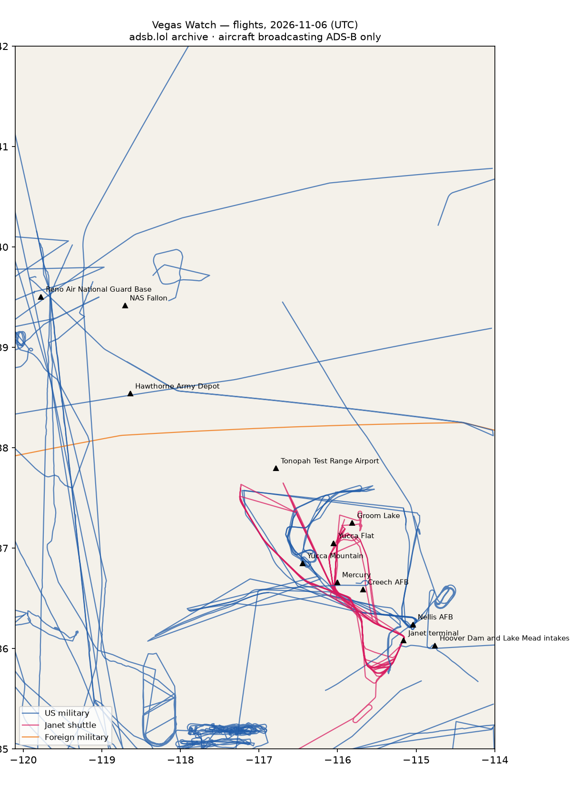

# RWI-W-VEGAS-2026-11-07 — Vegas Watch

*Las Vegas and the Nevada ranges. Daily open-source look; flights for 2026-11-06 (UTC), heat for 2026-11-06–2026-11-07, newest satellite passes. LLM-generated and automated.*

## Notable

- 1 foreign military aircraft in the area (Australia).

## Flights

91 aircraft kept: 46 US military, 0 Canadian military, 1 foreign military, 8 Janet, 0 state/VIP, 36 other (on the ground at a site, or near a range).

### Janet shuttles

| Callsign | Reg | Type | Seen (UTC) | Went to |
|---|---|---|---|---|
| JANET24 JANET25 JANET36 JANET37 JANET42 JANET43 JANET46 JANET55 JANET59 JANET68 JANET82 | N859WP | B736 | 00:00–23:59 | Groom Lake (within 25 km), Tonopah Test Range Airport (within 25 km) |
| JANET14 JANET17 JANET33 JANET48 JANET51 JANET83 JANET86 JANET88 | N869HH | B736 | 00:00–23:13 | Groom Lake (within 25 km) |
| JANET31 JANET59 JANET74 JANET84 | N273RH | B736 | 00:00–23:22 | — |
| JANET09 | N989RR | BE30 | 00:06–01:01 | — |
| JANET15 JANET26 JANET77 | N319BD | B736 | 00:06–13:26 | Groom Lake (within 25 km) |
| JANET13 JANET47 JANET48 JANET53 JANET62 JANET65 JANET76 | N288DP | B736 | 00:14–23:59 | Groom Lake (within 25 km) |
| JANET01 | N661BA | BE20 | 00:22–01:14 | Groom Lake (within 25 km) |
| JANET10 | N910CB | BE30 | 16:01–19:51 | Groom Lake (within 25 km) |

### Near Groom Lake and Tonopah Test Range Airport (within 25 km; ordinary traffic below 18,000 ft)

| Aircraft | Type | Category | Callsigns | Seen (UTC) | Sites |
|---|---|---|---|---|---|
| N859WP | B736 | janet | JANET24 JANET25 JANET36 JANET37 JANET42 JANET43 JANET46 JANET55 JANET59 JANET68 JANET82 | 00:00–23:59 | Groom Lake, Tonopah Test Range Airport |
| N869HH | B736 | janet | JANET14 JANET17 JANET33 JANET48 JANET51 JANET83 JANET86 JANET88 | 00:00–23:13 | Groom Lake |
| N288DP | B736 | janet | JANET13 JANET47 JANET48 JANET53 JANET62 JANET65 JANET76 | 00:14–23:59 | Groom Lake |
| N910CB | BE30 | janet | JANET10 | 16:01–19:51 | Groom Lake |
| N319BD | B736 | janet | JANET15 JANET26 JANET77 | 00:06–13:26 | Groom Lake |
| N661BA | BE20 | janet | JANET01 | 00:22–01:14 | Groom Lake |

### US military

T38 ×7, BE20 ×6, TEX2 ×4, H60 ×4, ? ×3, GLF4 ×2, C17 ×2, C30J ×2, GLF5 ×2, K35R ×2, EC45 ×2, C27J ×2, P8 ×1, C560 ×1, PC12 ×1, T34T ×1, LJ35 ×1, C130 ×1, R135 ×1, F5 ×1.

- 08-3922 TEX2 WEASEL01 at Nellis AFB 23:00 UTC
- 03-3682 TEX2 WEAZL03 at Nellis AFB 20:47 UTC
- 66-4337 T38 SCALP01 STORMY1 at Nellis AFB 18:45 UTC
- 00-3573 TEX2 WEASEL04 at Nellis AFB 23:04 UTC
- 65-10467 T38 SCALP03 STRMY03 at Nellis AFB 19:00 UTC
- 93-1039 C130 BRAVE39 at Nellis AFB 15:00 UTC
- 168177 H60 VVAC700 at Harry Reid International — Janet terminal 22:04 UTC
- 62-4135 R135 SNOOP35 at Nellis AFB 01:43 UTC

### Foreign military

- Australia: A30-005 E737 ASY061 17:36–20:45 UTC

### Landings and low passes by site

| Site | Military / government aircraft on the ground or ≤1,500 ft within 4 km; civil count |
|---|---|
| Nellis AFB (Red Flag, USAF Warfare Center) | 62-4135 R135 (SNOOP35) 01:43, 93-1039 C130 (BRAVE39) 15:00, 66-4337 T38 (SCALP01 STORMY1) 18:45, 65-10467 T38 (SCALP03 STRMY03) 19:00, 03-3682 TEX2 (WEAZL03) 20:47, 08-3922 TEX2 (WEASEL01) 23:00, 00-3573 TEX2 (WEASEL04) 23:04; 1 civil |
| Creech AFB (MQ-9 Reaper operations) | — |
| Groom Lake (Homey Airport, 'Area 51') | — |
| Tonopah Test Range Airport | — |
| Nevada National Security Site — Yucca Flat | — |
| Nevada National Security Site — Mercury | — |
| Yucca Mountain (proposed nuclear waste repository) | — |
| Harry Reid International — Janet terminal | N859WP B736 (JANET24 JANET25 JANET36 JANET37 JANET42 JANET43 JANET46 JANET55 JANET59 JANET68 JANET82) 00:00, N869HH B736 (JANET14 JANET17 JANET33 JANET48 JANET51 JANET83 JANET86 JANET88) 00:00, N319BD B736 (JANET15 JANET26 JANET77) 00:06, N288DP B736 (JANET13 JANET47 JANET48 JANET53 JANET62 JANET65 JANET76) 00:37, N989RR BE30 (JANET09) 00:58, N661BA BE20 (JANET01) 01:12, N273RH B736 (JANET31 JANET59 JANET74 JANET84) 03:06, N910CB BE30 (JANET10) 16:01, 168177 H60 (VVAC700) 22:04; 5 civil |
| Hoover Dam and Lake Mead intakes | — |
| NAS Fallon (Naval Aviation Warfighting Development Center, TOPGUN) | — |
| Hawthorne Army Depot | — |
| Reno Air National Guard Base (152nd Airlift Wing) | — |

## Heat

9 detections in the watch box (FIRMS area API (agent Gazda)); 0 inside a site box. The Nevada Test and Training Range includes live bombing ranges, so heat detections inside the range are expected and are listed, not flagged, unless they fall on an airfield or facility box.

| Date | UTC | Lat, lon | FRP | Satellite | Site / nearest |
|---|---|---|---|---|---|
| 2026-11-06 | 0854 | 36.356, -114.914 | 1.51 | N21 | Nellis AFB (Red Flag, USAF Warfare Center) (17.1 km) |
| 2026-11-06 | 0951 | 36.359, -114.910 | 1.72 | N20 | Nellis AFB (Red Flag, USAF Warfare Center) (17.6 km) |
| 2026-11-06 | 0951 | 36.382, -114.878 | 0.43 | N20 | Nellis AFB (Red Flag, USAF Warfare Center) (21.4 km) |
| 2026-11-07 | 0834 | 36.354, -114.913 | 2 | N21 | Nellis AFB (Red Flag, USAF Warfare Center) (17.1 km) |
| 2026-11-07 | 0932 | 36.357, -114.912 | 1.45 | N20 | Nellis AFB (Red Flag, USAF Warfare Center) (17.3 km) |
| 2026-11-07 | 0932 | 36.383, -114.880 | 0.69 | N20 | Nellis AFB (Red Flag, USAF Warfare Center) (21.4 km) |
| 2026-11-07 | 1017 | 36.358, -114.909 | 0.97 | N21 | Nellis AFB (Red Flag, USAF Warfare Center) (17.6 km) |
| 2026-11-07 | 1017 | 36.358, -114.909 | 0.9 | N21 | Nellis AFB (Red Flag, USAF Warfare Center) (17.6 km) |
| 2026-11-07 | 1017 | 36.383, -114.877 | 0.41 | N21 | Nellis AFB (Red Flag, USAF Warfare Center) (21.6 km) |

## Imagery

| Site | Newest clear Sentinel-2 pass (≤12 days) | |
|---|---|---|
| Nellis AFB (Red Flag, USAF Warfare Center) | 2026-11-05 18:34 UTC, 94% clear | no new pass |
| Creech AFB (MQ-9 Reaper operations) | 2026-11-05 18:44 UTC, 82% clear | no new pass |
| Groom Lake (Homey Airport, 'Area 51') | 2026-11-05 18:44 UTC, 99% clear | no new pass |
| Tonopah Test Range Airport | 2026-11-05 18:44 UTC, 100% clear | no new pass |
| Nevada National Security Site — Yucca Flat | 2026-11-05 18:44 UTC, 100% clear | no new pass |
| Harry Reid International — Janet terminal | none clear | |
| Hoover Dam and Lake Mead intakes | 2026-11-05 18:34 UTC, 100% clear | no new pass |

