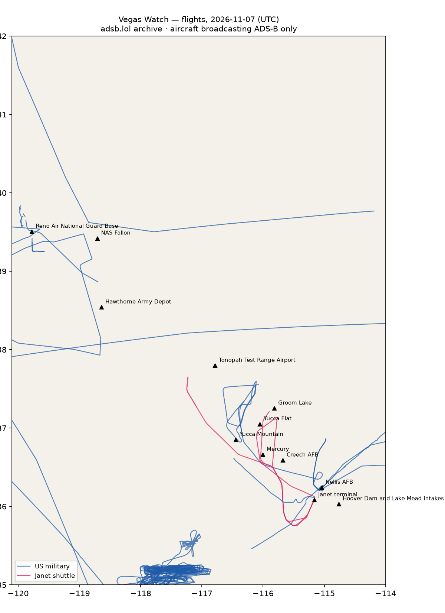

# RWI-W-VEGAS-2026-11-08 — Vegas Watch

*Las Vegas and the Nevada ranges. Daily open-source look; flights for 2026-11-07 (UTC), heat for 2026-11-07–2026-11-08, newest satellite passes. LLM-generated and automated.*

## Notable

- Nothing out of pattern.

## Flights

61 aircraft kept: 25 US military, 0 Canadian military, 0 foreign military, 2 Janet, 0 state/VIP, 34 other (on the ground at a site, or near a range).

### Janet shuttles

| Callsign | Reg | Type | Seen (UTC) | Went to |
|---|---|---|---|---|
| JANET59 JANET68 | N859WP | B736 | 00:00–01:54 | — |
| JANET25 JANET36 | N869HH | B736 | 01:28–04:31 | Groom Lake (within 25 km) |

### Near Groom Lake and Tonopah Test Range Airport (within 25 km; ordinary traffic below 18,000 ft)

| Aircraft | Type | Category | Callsigns | Seen (UTC) | Sites |
|---|---|---|---|---|---|
| N869HH | B736 | janet | JANET25 JANET36 | 01:28–04:31 | Groom Lake |

### US military

T38 ×8, C17 ×4, BE20 ×3, H60 ×2, C130 ×2, H47 ×2, R135 ×1, C30J ×1, C27J ×1, B737 ×1.

- 66-4379 T38 STORMY2 at Nellis AFB 00:18 UTC
- 66-4337 T38 STORMY1 at Nellis AFB 00:17 UTC
- 65-10467 T38 STRMY03 at Nellis AFB 00:43 UTC
- 13-20604 H60 R20604 at Nellis AFB 00:49 UTC
- 62-4135 R135 SHINR40 at Nellis AFB 20:21 UTC
- 168177 H60 VVAC700 at Harry Reid International — Janet terminal 16:34 UTC

### Foreign military

None broadcasting.

### Landings and low passes by site

| Site | Military / government aircraft on the ground or ≤1,500 ft within 4 km; civil count |
|---|---|
| Nellis AFB (Red Flag, USAF Warfare Center) | 66-4337 T38 (STORMY1) 00:17, 66-4379 T38 (STORMY2) 00:18, 65-10467 T38 (STRMY03) 00:43, 13-20604 H60 (R20604) 00:49, 62-4135 R135 (SHINR40) 20:21 |
| Creech AFB (MQ-9 Reaper operations) | — |
| Groom Lake (Homey Airport, 'Area 51') | — |
| Tonopah Test Range Airport | — |
| Nevada National Security Site — Yucca Flat | — |
| Nevada National Security Site — Mercury | — |
| Yucca Mountain (proposed nuclear waste repository) | — |
| Harry Reid International — Janet terminal | N859WP B736 (JANET59 JANET68) 01:49, N869HH B736 (JANET25 JANET36) 01:54, 168177 H60 (VVAC700) 16:34; 4 civil |
| Hoover Dam and Lake Mead intakes | — |
| NAS Fallon (Naval Aviation Warfighting Development Center, TOPGUN) | — |
| Hawthorne Army Depot | — |
| Reno Air National Guard Base (152nd Airlift Wing) | — |

## Heat

11 detections in the watch box (FIRMS area API (agent Gazda)); 0 inside a site box. The Nevada Test and Training Range includes live bombing ranges, so heat detections inside the range are expected and are listed, not flagged, unless they fall on an airfield or facility box.

| Date | UTC | Lat, lon | FRP | Satellite | Site / nearest |
|---|---|---|---|---|---|
| 2026-11-07 | 0834 | 36.354, -114.913 | 2 | N21 | Nellis AFB (Red Flag, USAF Warfare Center) (17.1 km) |
| 2026-11-07 | 0932 | 36.357, -114.912 | 1.45 | N20 | Nellis AFB (Red Flag, USAF Warfare Center) (17.3 km) |
| 2026-11-07 | 0932 | 36.383, -114.880 | 0.69 | N20 | Nellis AFB (Red Flag, USAF Warfare Center) (21.4 km) |
| 2026-11-07 | 1017 | 36.358, -114.909 | 0.97 | N21 | Nellis AFB (Red Flag, USAF Warfare Center) (17.6 km) |
| 2026-11-07 | 1017 | 36.358, -114.909 | 0.9 | N21 | Nellis AFB (Red Flag, USAF Warfare Center) (17.6 km) |
| 2026-11-07 | 1017 | 36.383, -114.877 | 0.41 | N21 | Nellis AFB (Red Flag, USAF Warfare Center) (21.6 km) |
| 2026-11-08 | 0913 | 36.357, -114.912 | 1.31 | N20 | Nellis AFB (Red Flag, USAF Warfare Center) (17.3 km) |
| 2026-11-08 | 0913 | 36.386, -114.876 | 0.5 | N20 | Nellis AFB (Red Flag, USAF Warfare Center) (21.8 km) |
| 2026-11-08 | 0956 | 36.359, -114.912 | 1.38 | N21 | Nellis AFB (Red Flag, USAF Warfare Center) (17.5 km) |
| 2026-11-08 | 0956 | 36.381, -114.877 | 0.71 | N21 | Nellis AFB (Red Flag, USAF Warfare Center) (21.4 km) |
| 2026-11-08 | 0956 | 36.381, -114.876 | 0.74 | N21 | Nellis AFB (Red Flag, USAF Warfare Center) (21.5 km) |

## Imagery

| Site | Newest clear Sentinel-2 pass (≤12 days) | |
|---|---|---|
| Nellis AFB (Red Flag, USAF Warfare Center) | 2026-11-05 18:34 UTC, 94% clear | no new pass |
| Creech AFB (MQ-9 Reaper operations) | 2026-11-08 18:44 UTC, 100% clear | [new plate](S2_creech-afb.jpg) |
| Groom Lake (Homey Airport, 'Area 51') | 2026-11-08 18:43 UTC, 100% clear | [new plate](S2_groom-lake.jpg) |
| Tonopah Test Range Airport | 2026-11-08 18:43 UTC, 100% clear | [new plate](S2_tonopah-test-range.jpg) |
| Nevada National Security Site — Yucca Flat | 2026-11-08 18:43 UTC, 100% clear | [new plate](S2_nnss-yucca-flat.jpg) |
| Harry Reid International — Janet terminal | none clear | |
| Hoover Dam and Lake Mead intakes | 2026-11-05 18:34 UTC, 100% clear | no new pass |

