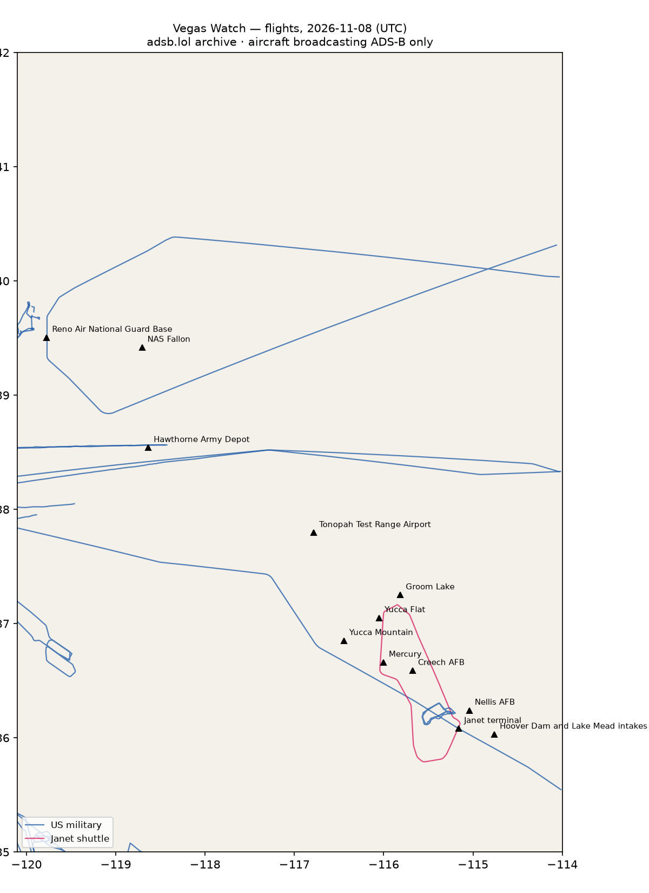

# RWI-W-VEGAS-2026-11-09 — Vegas Watch

*Las Vegas and the Nevada ranges. Daily open-source look; flights for 2026-11-08 (UTC), heat for 2026-11-08–2026-11-09, newest satellite passes. LLM-generated and automated.*

## Notable

- Nothing out of pattern.

## Flights

52 aircraft kept: 18 US military, 0 Canadian military, 0 foreign military, 1 Janet, 0 state/VIP, 33 other (on the ground at a site, or near a range).

### Janet shuttles

| Callsign | Reg | Type | Seen (UTC) | Went to |
|---|---|---|---|---|
| JANET09 | N989RR | BE30 | 22:04–23:26 | Groom Lake (within 25 km) |

### Near Groom Lake and Tonopah Test Range Airport (within 25 km; ordinary traffic below 18,000 ft)

| Aircraft | Type | Category | Callsigns | Seen (UTC) | Sites |
|---|---|---|---|---|---|
| N989RR | BE30 | janet | JANET09 | 22:04–23:26 | Groom Lake |

### US military

C30J ×4, H60 ×3, B737 ×2, C17 ×2, ? ×2, K35R ×1, E6 ×1, EC45 ×1, H47 ×1, C27J ×1.

- 166694 B737 CNV4116 CNV694 at Reno Air National Guard Base 19:10 UTC

### Foreign military

None broadcasting.

### Landings and low passes by site

| Site | Military / government aircraft on the ground or ≤1,500 ft within 4 km; civil count |
|---|---|
| Nellis AFB (Red Flag, USAF Warfare Center) | 1 civil |
| Creech AFB (MQ-9 Reaper operations) | — |
| Groom Lake (Homey Airport, 'Area 51') | — |
| Tonopah Test Range Airport | — |
| Nevada National Security Site — Yucca Flat | — |
| Nevada National Security Site — Mercury | — |
| Yucca Mountain (proposed nuclear waste repository) | — |
| Harry Reid International — Janet terminal | N989RR BE30 (JANET09) 22:04; 4 civil |
| Hoover Dam and Lake Mead intakes | — |
| NAS Fallon (Naval Aviation Warfighting Development Center, TOPGUN) | — |
| Hawthorne Army Depot | — |
| Reno Air National Guard Base (152nd Airlift Wing) | 166694 B737 (CNV4116 CNV694) 19:10 |

## Heat

11 detections in the watch box (FIRMS area API (agent Gazda)); 0 inside a site box. The Nevada Test and Training Range includes live bombing ranges, so heat detections inside the range are expected and are listed, not flagged, unless they fall on an airfield or facility box.

| Date | UTC | Lat, lon | FRP | Satellite | Site / nearest |
|---|---|---|---|---|---|
| 2026-11-08 | 0913 | 36.357, -114.912 | 1.31 | N20 | Nellis AFB (Red Flag, USAF Warfare Center) (17.3 km) |
| 2026-11-08 | 0913 | 36.386, -114.876 | 0.5 | N20 | Nellis AFB (Red Flag, USAF Warfare Center) (21.8 km) |
| 2026-11-08 | 0956 | 36.359, -114.912 | 1.38 | N21 | Nellis AFB (Red Flag, USAF Warfare Center) (17.5 km) |
| 2026-11-08 | 0956 | 36.381, -114.877 | 0.71 | N21 | Nellis AFB (Red Flag, USAF Warfare Center) (21.4 km) |
| 2026-11-08 | 0956 | 36.381, -114.876 | 0.74 | N21 | Nellis AFB (Red Flag, USAF Warfare Center) (21.5 km) |
| 2026-11-09 | 0854 | 36.358, -114.913 | 1.59 | N20 | Nellis AFB (Red Flag, USAF Warfare Center) (17.3 km) |
| 2026-11-09 | 0854 | 36.382, -114.879 | 0.44 | N20 | Nellis AFB (Red Flag, USAF Warfare Center) (21.4 km) |
| 2026-11-09 | 0938 | 36.355, -114.910 | 0.47 | N21 | Nellis AFB (Red Flag, USAF Warfare Center) (17.3 km) |
| 2026-11-09 | 0938 | 36.358, -114.909 | 0.39 | N21 | Nellis AFB (Red Flag, USAF Warfare Center) (17.7 km) |
| 2026-11-09 | 0938 | 36.384, -114.874 | 0.72 | N21 | Nellis AFB (Red Flag, USAF Warfare Center) (21.8 km) |
| 2026-11-09 | 1034 | 36.360, -114.911 | 1.46 | N20 | Nellis AFB (Red Flag, USAF Warfare Center) (17.6 km) |

## Imagery

| Site | Newest clear Sentinel-2 pass (≤12 days) | |
|---|---|---|
| Nellis AFB (Red Flag, USAF Warfare Center) | 2026-11-05 18:34 UTC, 94% clear | no new pass |
| Creech AFB (MQ-9 Reaper operations) | 2026-11-08 18:44 UTC, 100% clear | no new pass |
| Groom Lake (Homey Airport, 'Area 51') | 2026-11-08 18:43 UTC, 100% clear | no new pass |
| Tonopah Test Range Airport | 2026-11-08 18:43 UTC, 100% clear | no new pass |
| Nevada National Security Site — Yucca Flat | 2026-11-08 18:43 UTC, 100% clear | no new pass |
| Nevada National Security Site — Mercury | 2026-11-08 18:44 UTC, 100% clear | no new pass |
| Yucca Mountain (proposed nuclear waste repository) | 2026-11-08 18:44 UTC, 100% clear | no new pass |
| Harry Reid International — Janet terminal | none clear | |
| Hoover Dam and Lake Mead intakes | 2026-11-05 18:34 UTC, 100% clear | no new pass |
| NAS Fallon (Naval Aviation Warfighting Development Center, TOPGUN) | 2026-11-06 18:53 UTC, 82% clear | no new pass |
| Hawthorne Army Depot | 2026-11-06 18:53 UTC, 100% clear | no new pass |
| Reno Air National Guard Base (152nd Airlift Wing) | 2026-11-04 19:03 UTC, 90% clear | no new pass |

